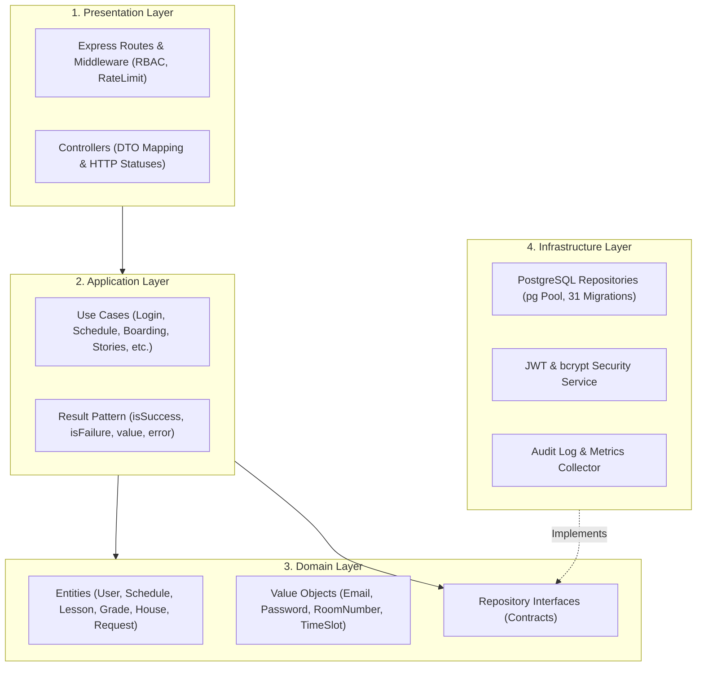

# PrimakovApp

[](backend/)
[](backend/)
[-336791?logo=postgresql&logoColor=white)](backend/src/infrastructure/database/migrations/)
[](flutter/)
[](admin-web/)
[](backend/tests/)
[](flutter/test/)
[](docs/architecture.md)
[-blue)](#-bilingual-localization-ru--en)

An enterprise-grade, cross-platform digital campus assistant and administrative operating system tailored for the individualized educational workflows of **Primakov School (Gymnasium)**.

---

## 🌟 Executive Overview

**PrimakovApp** is a unified digital ecosystem designed for students, teachers, campus residents, and school administration. Unlike generic electronic diaries (such as MES or Dnevnik.ru), this solution addresses the high-touch, individualized campus environment of an elite international school:

- **Personalized Schedule Grid**: Dynamic, individualized lesson schedules tracking rooms, faculty members, and real-time room assignments rather than generic class-wide timetables.
- **Academic Progress & GPA Simulator**: Electronic gradebook with weighted scoring (1 / 1.5 / 2), GPA forecasting, and interactive grade target simulation.
- **House Cup League (Кубок Лиги Домов)**: Gamified tournament system among 4 Houses (*North, South, East, West*) tracking athletics, academics, arts, and volunteering.
- **Boarding Life & Campus Residence**: Full digital cycle for boarding students — digital QR gate passes, evening roll call with GPS campus geofencing, and 1-click leave requests.
- **Campus Media & Announcements**: Rich Telegram/Instagram-style Stories with image/video support and interactive link pills, alongside Apple-style interactive bottom-sheet announcements.
- **Primakov School Admin Web**: A centralized administration portal featuring the Product Health & System Pulse dashboard (tracking DAU, student attendance, helpdesk SLA, and CSI ratings) with dynamic data management and responsive mobile drawer navigation.

---

## 📸 Screenshots & Visual Tour

> [!TIP]
> High-resolution screenshots of both the mobile application and the administration portal are maintained in [`docs/screenshots/`](docs/screenshots/).

### Mobile Application (Flutter — iOS & Android)

| Daily Schedule & Stories | GPA Simulator (Progress) | House Cup League |
| :---: | :---: | :---: |
|  <br><sub>*Dynamic schedule with room badges & stories carousel*</sub> |  <br><sub>*Weighted GPA & predictive grade forecasting*</sub> |  <br><sub>*Leaderboard for North, South, East & West*</sub> |

| Boarding Life (QR & GPS) | Canteen & Nutrition | Announcements Sheet |
| :---: | :---: | :---: |
|  <br><sub>*Digital gate pass & geofenced evening roll call*</sub> |  <br><sub>*Daily menu, KBJU calories & allergens*</sub> |  <br><sub>*Interactive bottom sheet with copy action*</sub> |

### Web Administration Portal (`admin-web` — React 19)

| Product Health & System Pulse | Stories & Announcements CMS | Responsive Mobile Admin View |
| :---: | :---: | :---: |
|  <br><sub>*Executive dashboard: DAU, attendance, SLA, CSI*</sub> |  <br><sub>*Publishing stories with links & announcements*</sub> |  <br><sub>*Touch-friendly navigation drawer & bottom bar*</sub> |

---

## 🚀 Key Modules & Ecosystem Capabilities

### 📅 1. Dynamic Timetable & Schedule Management
- Displays individual lesson timelines with room assignments, teacher profiles, and active lesson highlights.
- Prevents double-booking and schedule collisions at both domain entity and database levels.
- Full offline caching using Hive: students can check today's schedule and classrooms even without an active internet connection.

### 📊 2. Academic Progress & GPA Simulator
- Direct integration with MES-style weighted evaluations (configurable weights: 1.0 for homework, 1.5 for quizzes, 2.0 for major exams).
- Interactive **GPA Simulator**: students can simulate hypothetical upcoming test scores to see the exact impact on their quarterly or trimester average.

### 🏆 3. House Cup League (Кубок Лиги Домов)
- Gamified school spirit tournament connecting the 4 student Houses: **North (Север)**, **South (Юг)**, **East (Восток)**, and **West (Запад)**.
- Live tournament leaderboard, audited point history, and seasonal achievement badges for academic olympiads, sports, and arts.

### 🏕️ 4. Boarding Life & Campus Residence
- **Digital QR Gate Pass**: Secure QR code display for campus security gate clearance.
- **Evening Roll Call (GPS Geofenced)**: Students confirm evening presence with geofencing validation to ensure they are on campus grounds.
- **Weekend Leave Requests**: Students submit leave applications with parental permissions, enabling wardens to review and approve in 1 click.

### 📸 5. Campus Stories & Announcements
- **Stories**: Multimedia stories (photos, videos, captions, external clickable action pills, and hold-to-pause).
- **Announcements**: Interactive modal bottom sheets with 1-tap clipboard copying and important date badges.

### 🍽️ 6. Canteen Menu & Nutritional Calculator
- Real-time weekly dining hall menus categorized by meal (Breakfast, Lunch, Afternoon Snack, Dinner).
- Full nutritional metrics: total calories, proteins, fats, carbohydrates (KBJU), and allergen warnings (gluten, lactose, nuts).

### 👥 7. Campus Directory & Omnisearch
- Instant search across faculties and student rosters.
- Birthday indicators (🎂) with celebratory highlights and 1-tap actions to contact via Telegram, phone, or email.

### 🛠️ 8. Service Desk & Maintenance Requests
- Facility tickets for IT support, furniture repair, and cleaning services.
- Priority levels (Low, Medium, High, Critical) with automated SLA countdown timers.

### ⭐️ 9. Anonymous Teacher Feedback
- Constructive feedback collection mechanism with device-fingerprinting rate limits to prevent vote manipulation and spamming.

### 🌐 10. Bilingual Localization (RU / EN)
- Complete two-way bilingual interface across both mobile and web administrative portals.
- Dynamic runtime language switching without requiring application restarts.

### 🎨 11. Primakov Noble Design System
- Signature Primakov visual language: Noble Crimson, Deep Navy, and Warm Alabaster palette.
- Modern vector iconography via **Lucide Icons**.
- Smooth transitions powered by `flutter_animate` and celebration micro-interactions with `confetti`.
- Native Light and Dark themes with strict WCAG contrast compliance.

---

## 🏛️ Architecture & Design Principles

The backend architecture strictly complies with **Clean Architecture** and **Domain-Driven Design (DDD)** principles:



### Core Architecture Rules
1. **Layer Isolation**: Controllers never execute SQL or access databases directly. All data access occurs through repository interfaces.
2. **Result Pattern**: Use cases return strongly-typed Result objects (`Result.ok(value)` or `Result.fail(error)`), avoiding uncaught exception escapes.
3. **Database Security**: UUID primary keys for all entities; passwords strictly hashed using `bcrypt` (10 rounds); JWT tokens with a 7-day lifespan.
4. **Zero Secrets in Repository**: No credentials or private keys are stored in source code. All configuration is injected via `.env` files validated at runtime by `validateEnv.ts`.

---

## 💻 Technology Stack

### Backend
| Component | Technology | Version | Purpose |
| :--- | :--- | :--- | :--- |
| **Runtime** | Node.js | `>= 20.10.x LTS` | Server JavaScript runtime |
| **Language** | TypeScript | `^5.3.3` | Type safety and domain contracts |
| **Web Framework** | Express.js | `^4.18.2` | REST API routing and middleware |
| **Database** | PostgreSQL | `15 (Alpine)` | Primary relational datastore (31 migrations) |
| **Database Driver** | `pg` (node-postgres) | `^8.20.0` | Connection pooling and parameterized SQL queries |
| **Validation** | Zod | `^4.4.1` | Request schema validation |
| **Security** | Helmet, bcrypt, rate-limit | Latest | HTTP security headers, 10-round password hashing, DDoS mitigation |
| **Testing** | Jest + ts-jest + Supertest | `^29.7.0` | Comprehensive unit and integration test suite |

### Frontend (Mobile App)
| Component | Technology | Version | Purpose |
| :--- | :--- | :--- | :--- |
| **Framework** | Flutter SDK | `>= 3.0.0 < 4.0.0` (Dart 3.x) | Cross-platform client for iOS & Android |
| **State Management** | Flutter Riverpod | `^2.4.0` | Reactive state management and dependency injection |
| **Networking** | Dio | `^5.3.0` | HTTP client with automatic JWT bearer interceptors |
| **Offline Cache** | Hive & Shared Preferences | Latest | Fast NoSQL offline storage for schedules and user sessions |
| **UI & Animations** | `flutter_animate`, `confetti` | Latest | Fluid transitions and completion micro-interactions |
| **Icons & Typography** | `lucide_icons`, Google Fonts | Latest | Primakov brand typography (Manrope & Inter) |

### Frontend (Web Admin Portal)
| Component | Technology | Version | Purpose |
| :--- | :--- | :--- | :--- |
| **Framework** | React 19 | `^19.0.0` | Modern reactive UI library |
| **Build Tool** | Vite | `^6.0.0` | Blazing-fast development and optimized production bundling |
| **Styling** | Tailwind CSS v4 | `^4.0.0` | Utility-first responsive design and design tokens |
| **Icons** | Lucide React | `^0.469.0` | Premium vector icons |

---

## 🛠️ Getting Started & Local Development

### Prerequisites
- **Node.js**: `v20.x LTS`
- **Flutter SDK**: `v3.0.0` or higher
- **PostgreSQL**: `v14+` (or Docker)
- **Git**

### 1. Clone the Repository
```bash
git clone https://github.com/sashamosk17/Primakov_App.git
cd Primakov_App
```

### 2. Backend Setup
```bash
cd backend
npm install

# Copy environment configuration
cp .env.example .env

# Run database migrations
npm run migrate

# Start development server
npm run dev
```
The backend API will be available at `http://localhost:3000/api` with healthcheck at `http://localhost:3000/health`.

### 3. Web Admin Setup
```bash
cd ../admin-web
npm install
npm run dev
```
The admin portal will be running at `http://localhost:5173`.

### 4. Mobile App Setup (Flutter)
```bash
cd ../flutter
flutter pub get

# Run on connected device or emulator with target API
flutter run --dart-define=API_BASE_URL=http://localhost:3000/api
```

---

## 📦 Building Applications for Distribution

### Building Android APK
```bash
cd flutter
flutter build apk --dart-define=API_BASE_URL=http://185.221.198.242:3000/api
```
The output file will be generated at:
```
flutter/build/app/outputs/flutter-apk/app-release.apk
```

### Building for iOS
1. Open `flutter/ios/Runner.xcworkspace` in Xcode on macOS.
2. Select your development Team in **Signing & Capabilities**.
3. Connect your physical iOS device or choose a Simulator.
4. Press **Run** (or `Cmd + R`).

---

## 🌐 Production Server & Live Deployment

The production backend is hosted on a secure VPS in Docker containers:
- **API Base URL**: `http://185.221.198.242:3000/api`
- **Healthcheck**: `http://185.221.198.242:3000/health`
- **Container Topology**:
  - `primakov-backend`: Node.js 20 production container
  - `primakov-postgres`: PostgreSQL 15 database container
  - `primakov-nginx`: Reverse proxy with SSL termination
  - `primakov-certbot`: Automated Let's Encrypt certificate renewal daemon

Detailed deployment, database migration, and backup maintenance instructions are documented in:
- 📖 [Deployment & Architecture Guide](docs/DEPLOYMENT_GUIDE.md)
- 🛠️ [Server Operations & Troubleshooting Guide](docs/SERVER_UPDATE_GUIDE.md)

---

## 🧪 Testing & Quality Assurance

The project enforces strict automated testing across all layers:

### Running Backend Tests
```bash
cd backend
npm test
```
- **Backend Test Coverage**: **369 tests across 44 test suites passing** (`100% green`).
- Covers unit domain models, use cases, controller routing, RBAC guards, and integration flows.

### Running Flutter Tests
```bash
cd flutter
flutter test
```
- **Mobile Test Coverage**: **54 tests passing** (`100% green`).
- Covers widget interactions, offline cache fallbacks, GPA calculation logic, and design system tokens.

---

## 🔒 Security Audit & Credentials Compliance

In compliance with repository hygiene and security standards:
- **Zero Secrets Committed**: No `.env` files containing production secrets are tracked in Git.
- **Strict `.gitignore`**: Blocks `.env`, `.env.*.local`, keystores (`*.jks`, `*.keystore`), certificates (`*.pem`, `*.key`), and build artifacts.
- **Environment Validation**: Server startup performs proactive checks on `JWT_SECRET` length and environment variables via [`validateEnv.ts`](backend/src/infrastructure/config/validateEnv.ts).
- **Password Hashing**: Bcrypt with 10 salt rounds used for all user credentials.

---

## 📁 Repository Structure

```
Primakov_App/
├── admin-web/             # React 19 + Vite + Tailwind CSS Web Admin Portal
│   ├── src/               # Admin pages, components, and API client
│   └── public/            # Static assets and logo
├── backend/               # Node.js + Express + TypeScript Backend
│   ├── src/
│   │   ├── domain/        # Entities, Value Objects, Repository Interfaces
│   │   ├── application/   # Use Cases (Business Logic)
│   │   ├── infrastructure/# Database, Repositories, Config, Security
│   │   └── presentation/  # Routes, Controllers, Middleware
│   ├── scripts/           # Migration runners, seed scripts, ops scripts
│   └── tests/             # 44 Jest test suites (369 tests)
├── flutter/               # Flutter 3.x Cross-platform Mobile Application
│   ├── lib/
│   │   ├── config/        # Design system, themes, localization, API config
│   │   ├── models/        # Data models and JSON serialization
│   │   ├── providers/     # Riverpod state providers and caching
│   │   ├── screens/       # Application views (Schedule, GPA, Boarding, etc.)
│   │   └── services/      # Dio API clients and storage services
│   └── test/              # 54 Flutter widget and unit tests
├── docs/                  # Technical & Academic Project Documentation
│   ├── screenshots/       # Visual screenshots of mobile and web interfaces
│   ├── architecture.md    # Clean Architecture & DB diagrams
│   ├── database.md        # Complete database schema and migration catalog
│   ├── features.md        # Comprehensive functional catalog
│   ├── DEPLOYMENT_GUIDE.md# Docker deployment and server setup
│   ├── SERVER_UPDATE_GUIDE.md # Maintenance and troubleshooting manual
│   └── защита.md          # Project defense strategy, DAU metrics & Q&A
└── README.md              # Project Master README (English)
```

---

## 🎓 Academic & Team Context

This project was developed as a flagship capstone initiative within the **Digital Product Management** program at **HSE University (Higher School of Economics)**.

- **Developer & Product Lead**: Aleksandr Moskalevich
- **Target Organization**: Primakov School (Gymnasium named after E.M. Primakov)
- **Defense Documentation**: See [`docs/защита.md`](docs/защита.md) for product strategy, North Star Metric (DAU) rationale, and stakeholder ROI.

---

## 📄 License

This repository is maintained for educational and operational use for Primakov School. All rights reserved.
