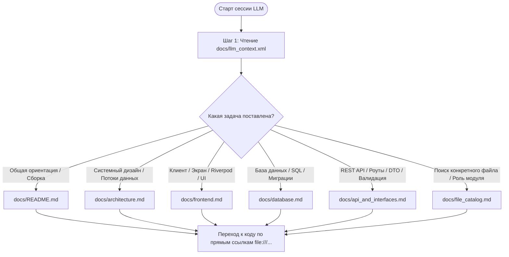

# PrimakovApp Documentation Hub

Центральный портал технической и архитектурной документации кроссплатформенного образовательного комплекса **PrimakovApp** («Гимназия им. Е.М. Примакова»).

---

## 1. Назначение проекта и скоуп

**PrimakovApp** — цифровая экосистема сервисов для учащихся, преподавателей и администрации гимназии. В отличие от типовых систем (МЭШ, Дневник.ру), решение спроектировано под индивидуализированный учебный процесс гимназии:
- Персонализированное расписание каждого ученика (не просто сетка по классу).
- Интегрированный трекер дедлайнов и домашних заданий.
- Анонимный рейтинг преподавателей с оптимистической блокировкой и защитой от накрутки.
- Новостная лента в формате Stories с внешними гиперссылками.
- Интерактивное меню столовой с расчетом калорийности, КБЖУ и аллергенов.
- Навигация по кампусу (поиск аудиторий по корпусам, этажам и координатам).
- Сервис внутренних заявок (IT-поддержка, хозяйственная служба, клининг).
- Ролевая модель доступа (RBAC) с JWT-аутентификацией.

---

## 2. Технологический стек (Tech Stack)

### 2.1. Backend (Серверная часть)
| Компонент / Слой | Технология | Версия / Требования | Назначение |
| :--- | :--- | :--- | :--- |
| **Runtime** | Node.js | `>= 20.10.x LTS` | Среда выполнения JavaScript |
| **Язык** | TypeScript | `^5.3.3` | Строгая статическая типизация |
| **Веб-фреймворк** | Express.js | `^4.18.2` | Маршрутизация, контроллеры, middleware |
| **СУБД** | PostgreSQL | `>= 14.x` | Реляционная база данных |
| **Драйвер БД** | `pg` (node-postgres) | `^8.20.0` | Пул соединений и выполнение SQL-запросов |
| **Валидация данных** | Zod | `^4.4.1` | Валидация схем запросов на уровне контроллеров |
| **Безопасность** | Helmet | `^8.1.0` | Установка защитных HTTP-заголовков |
| **Ограничение частоты**| express-rate-limit | `^8.4.1` | Защита от DDoS и брутфорса |
| **Хеширование паролей**| bcrypt | `^6.0.0` | Соленое хеширование учетных записей |
| **Аутентификация** | jsonwebtoken | `^9.0.2` | Выпуск и верификация токенов (TTL: 7 дней) |
| **Тестирование** | Jest + ts-jest | `^29.7.0` | Модульные и интеграционные тесты |
| **Контейнеризация** | Docker / Compose | Docker v24+, Compose v2+ | Развертывание сервиса и базы данных |

### 2.2. Frontend (Мобильное приложение)
| Компонент / Слой | Технология | Версия / Требования | Назначение |
| :--- | :--- | :--- | :--- |
| **Фреймворк** | Flutter SDK | `>= 3.0.0 < 4.0.0` (Dart 3.x) | Кроссплатформенный UI-движок (Android/iOS) |
| **Управление состоянием**| flutter_riverpod | `^2.4.0` | Реактивный State Management, DI |
| **Кодогенерация state**| riverpod_annotation | `^2.2.0` / `build_runner` | Типобезопасные провайдеры |
| **HTTP-клиент** | Dio | `^5.3.0` | Сетевые запросы, перехватчики (JWT, логи) |
| **Локальное хранилище**| shared_preferences | `^2.2.0` | Хранение JWT токена и UI-настроек |
| **Локализация и даты**| intl, flutter_localizations | `^0.20.2` | Форматирование дат, календарей и чисел |
| **Векторная графика** | flutter_svg | `^2.0.0` | Рендеринг SVG-иконок и иллюстраций |
| **Внешние ссылки** | url_launcher | `^6.2.0` | Переход по ссылкам из Stories и контактов |
| **Анимации** | confetti | `^0.7.0` | Визуальные микроэффекты завершения дедлайнов |
| **Типографика** | Google Fonts Manrope & Inter | Локальные шрифты | Корпоративный шрифт гимназии |

---

## 3. Инструкции по сборке и запуску

### 3.1. Запуск Backend

#### 3.1.1. Локальная разработка (Node.js + PostgreSQL)
1. Убедитесь, что установлены `Node.js 20+` и запущен сервер `PostgreSQL 14+`.
2. Перейдите в каталог бэкенда:
   ```bash
   cd backend
   ```
3. Скопируйте файл переменных окружения:
   ```bash
   cp .env.example .env
   ```
   *Параметры `.env`:*
   ```ini
   PORT=3000
   NODE_ENV=development
   DB_HOST=localhost
   DB_PORT=5432
   DB_NAME=primakov_app
   DB_USER=postgres
   DB_PASSWORD=your_password
   DB_POOL_MAX=20
   DB_POOL_IDLE_TIMEOUT=30000
   DB_POOL_CONNECTION_TIMEOUT=2000
   JWT_SECRET=super_secret_jwt_key_at_least_32_chars_long
   JWT_EXPIRES_IN=7d
   CORS_ORIGIN=*
   ```
4. Установите зависимости:
   ```bash
   npm install
   ```
5. Запустите сервер в режиме разработки (миграции накатываются автоматически при старте через [migrationRunner.ts](file:///c:/Users/sasha/ВШЭ/3%20курс/Digital_PM/Primakov_App/backend/src/infrastructure/database/migrations/migrationRunner.ts)):
   ```bash
   npm run dev
   ```
6. Сборка production-бандла и запуск:
   ```bash
   npm run build
   npm start
   ```

#### 3.1.2. Запуск через Docker Compose (Production на сервере)
Сервер развернут на VPS по адресу `185.221.198.242` с использованием Docker Compose:
```bash
cd backend
docker compose -f docker-compose.prod.yml up -d --build
```
Для быстрого обновления бэкенда на сервере используется готовый скрипт:
```bash
./scripts/server/deploy.sh
```
Подробная инструкция, параметры окружения и регламент бэкапов описаны в [docs/DEPLOYMENT_GUIDE.md](DEPLOYMENT_GUIDE.md).

#### 3.1.3. Проверка работоспособности (Healthcheck)
- Эндпоинт проверки здоровья: `http://185.221.198.242:3000/health` (или локально `http://localhost:3000/health`).
- Возвращает JSON: `{ "status": "ok", "uptime": 120, "database": "connected", "version": "0.2.0" }`.

---

### 3.2. Сборка и запуск Flutter приложения

1. Перейдите в каталог `flutter`:
   ```bash
   cd flutter
   ```
2. Установите зависимости Flutter:
   ```bash
   flutter pub get
   ```
3. Запуск в режиме отладки:
   ```bash
   flutter run --dart-define=API_BASE_URL=http://localhost:3000/api
   ```
4. Сборка релизного APK (Android):
   ```bash
   flutter build apk --release --dart-define=API_BASE_URL=http://185.221.198.242:3000/api
   ```
   *Результат:* `flutter/build/app/outputs/flutter-apk/app-release.apk`
5. Сборка для iOS:
   - Откройте `flutter/ios/Runner.xcworkspace` в Xcode.
   - Настройте `Signing & Capabilities` (Team, Bundle Identifier).
   - Выполните сборку через Cmd+R или команду:
   ```bash
   flutter build ios --release --no-codesign --dart-define=API_BASE_URL=http://185.221.198.242:3000/api
   ```

---

## 4. Структура проекта (Repository Layout)

```text
Primakov_App/
├── backend/                              # Серверное приложение на Node.js / TypeScript
│   ├── src/
│   │   ├── domain/                       # Слой ядра предметной области (Entities, Value Objects, Interfaces)
│   │   ├── application/                  # Сценарии использования (Use Cases)
│   │   ├── infrastructure/               # Реализации репозиториев (PostgreSQL, Memory), конфиги, миграции
│   │   ├── presentation/                 # REST API: роуты, контроллеры, middleware
│   │   ├── shared/                       # Общие типы, роли (RBAC), утилиты
│   │   └── main.ts                       # Точка входа: DI-сборка, запуск сервера
│   ├── tests/                            # Модульные и интеграционные тесты
│   ├── Dockerfile                        # Докеризация Node.js
│   └── package.json                      # Зависимости и скрипты
├── flutter/                              # Мобильный клиент на Flutter / Dart
│   ├── lib/
│   │   ├── config/                       # Конфигурация API, тем, типографики, палитры цветов
│   │   ├── models/                       # Модели данных (DTO, Json-десериализация)
│   │   ├── providers/                    # Riverpod провайдеры состояния
│   │   ├── screens/                      # Экраны приложения (Авторизация, Расписание, Дедлайны, Меню и др.)
│   │   ├── services/api/                 # API-клиенты на Dio для каждого домена
│   │   ├── widgets/                      # Переиспользуемые UI-компоненты
│   │   └── main.dart                     # Точка входа Flutter приложения
│   ├── assets/                           # Шрифты Manrope/Inter, SVG-иконки, изображения
│   └── pubspec.yaml                      # Зависимости Flutter
└── docs/                                 # Документация проекта (LLM-ready)
    ├── README.md                         # Точка входа в документацию (текущий файл)
    ├── architecture.md                   # Системный дизайн, DDD, C4 и UML диаграммы
    ├── frontend.md                       # Детальная архитектура Flutter, экранов, провайдеров и виджетов
    ├── database.md                       # Полная спецификация БД PostgreSQL, схемы таблиц и миграций
    ├── api_and_interfaces.md             # Спецификация REST API и контрактов
    ├── file_catalog.md                   # Пофайловый реестр всех модулей проекта с описанием их роли
    └── llm_context.xml                   # Высокоплотный XML-манифест для контекста нейросетей
```

---

## 5. Карта документации (Documentation Map)

| Документ | Основное содержание | Целевая аудитория |
| :--- | :--- | :--- |
| [docs/README.md](file:///c:/Users/sasha/ВШЭ/3%20курс/Digital_PM/Primakov_App/docs/README.md) | Назначение, стек технологий, инструкции сборки и развертывания, алгоритм навигации LLM | Разработчики, DevOps, LLM |
| [docs/architecture.md](file:///c:/Users/sasha/ВШЭ/3%20курс/Digital_PM/Primakov_App/docs/architecture.md) | Чистая архитектура (DDD), схемы взаимодействия, Mermaid C4/Sequence диаграммы, ERD базы данных, алгоритмические решения | Архитекторы, Senior Devs, LLM |
| [docs/frontend.md](file:///c:/Users/sasha/ВШЭ/3%20курс/Digital_PM/Primakov_App/docs/frontend.md) | Полная декомпозиция Flutter: 18 экранов, 11 Riverpod-провайдеров, 10 кастомных виджетов, дизайн-система | Flutter Developers, UI/UX, LLM |
| [docs/database.md](file:///c:/Users/sasha/ВШЭ/3%20курс/Digital_PM/Primakov_App/docs/database.md) | Спецификация PostgreSQL: 12 таблиц, типы столбцов, ключи, индексы, мягкое удаление, OCC, реестр 17 миграций | Backend Devs, DBA, LLM |
| [docs/api_and_interfaces.md](file:///c:/Users/sasha/ВШЭ/3%20курс/Digital_PM/Primakov_App/docs/api_and_interfaces.md) | Контракты REST API (все 10 эндпоинтов), DTO, валидация Zod, обработка edge cases | Frontend/Backend Devs, QA, LLM |
| [docs/file_catalog.md](file:///c:/Users/sasha/ВШЭ/3%20курс/Digital_PM/Primakov_App/docs/file_catalog.md) | Реестр абсолютно каждого исходного файла проекта с его ролью, экспортами и зависимостями | Code Reviewers, LLM |
| [docs/llm_context.xml](file:///c:/Users/sasha/ВШЭ/3%20курс/Digital_PM/Primakov_App/docs/llm_context.xml) | Высокоплотный структурированный XML-манифест проекта со всеми правилами, сущностями и актуальным статусом | LLM (Claude, Gemini, GPT) |

---

## 6. Алгоритм навигации LLM по документации (LLM Traversal Pipeline)

Для нейросетей (LLM) и разработчиков чтение документации организовано в строгом иерархическом порядке:



### Как LLM использует эту структуру:
1. **Первичная загрузка контекста**: Нейросеть сначала считывает [docs/llm_context.xml](file:///c:/Users/sasha/ВШЭ/3%20курс/Digital_PM/Primakov_App/docs/llm_context.xml). За счет машиночитаемого формата XML с высокой плотностью фактов LLM сразу получает ментальную модель всего репозитория: правила кодогенерации, архитектурные слои, ограничения, перечень компонентов и текущий статус разработки.
2. **Маршрутизация**: Если задаче требуется детальный контекст, LLM обращается к `docs/README.md` (или карте документации) и точечно подгружает нужный специализированный файл:
   - При вопросах по Flutter, Riverpod, UI-багам или верстке $\rightarrow$ [docs/frontend.md](file:///c:/Users/sasha/ВШЭ/3%20курс/Digital_PM/Primakov_App/docs/frontend.md).
   - При вопросах по таблицам, внешним ключам, индексам или миграциям $\rightarrow$ [docs/database.md](file:///c:/Users/sasha/ВШЭ/3%20курс/Digital_PM/Primakov_App/docs/database.md).
   - При добавлении или изменении эндпоинтов, DTO или кодов ошибок $\rightarrow$ [docs/api_and_interfaces.md](file:///c:/Users/sasha/ВШЭ/3%20курс/Digital_PM/Primakov_App/docs/api_and_interfaces.md).
   - При проверке архитектурных границ и паттернов Clean Architecture $\rightarrow$ [docs/architecture.md](file:///c:/Users/sasha/ВШЭ/3%20курс/Digital_PM/Primakov_App/docs/architecture.md).
   - При поиске конкретного исходного файла проекта $\rightarrow$ [docs/file_catalog.md](file:///c:/Users/sasha/ВШЭ/3%20курс/Digital_PM/Primakov_App/docs/file_catalog.md).
3. **Навигация в исходный код**: Все документы содержат прямые кликабельные ссылки на файлы исходного кода (`file:///...`), что исключает галлюцинации путей и файлов.
