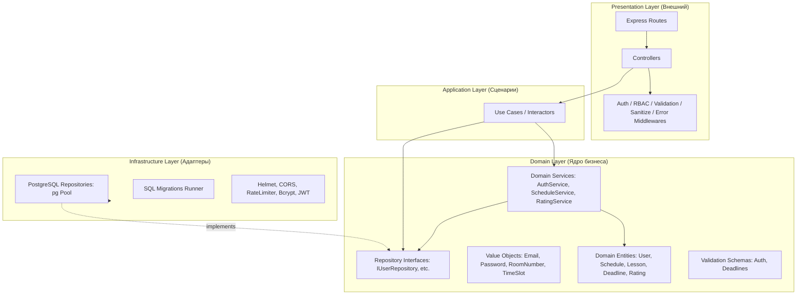
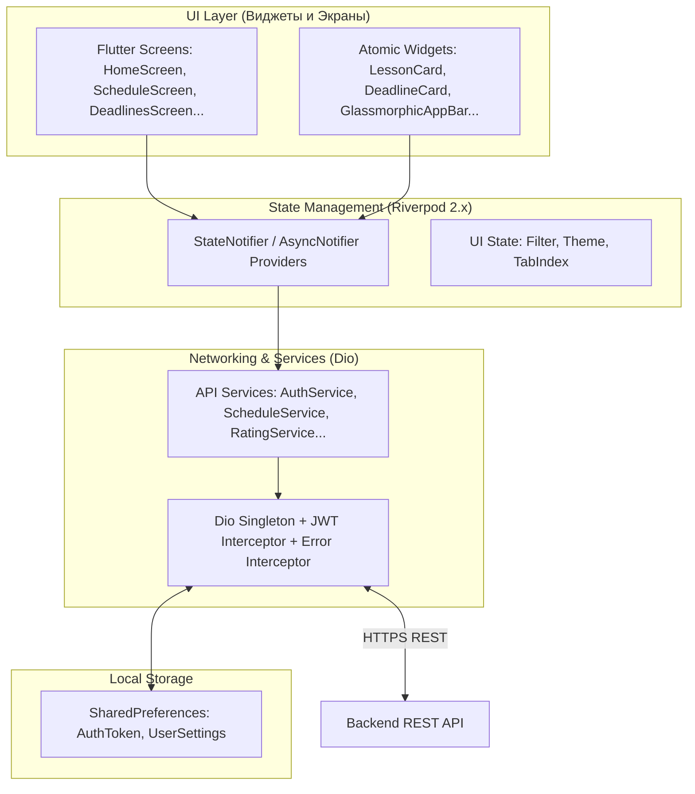
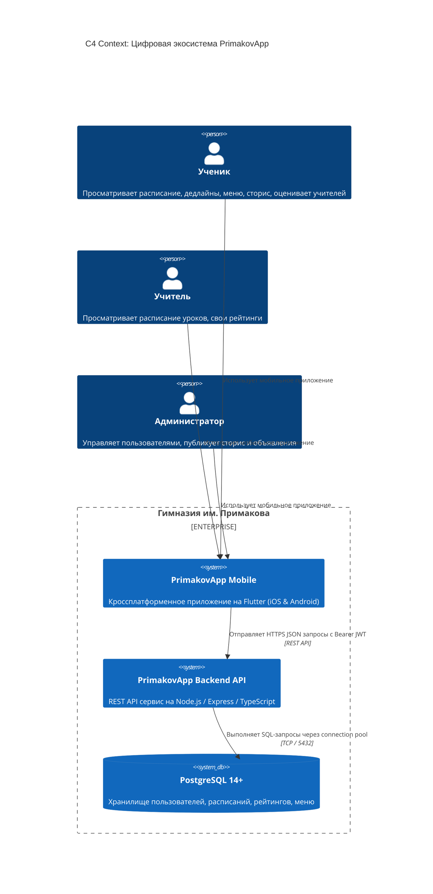
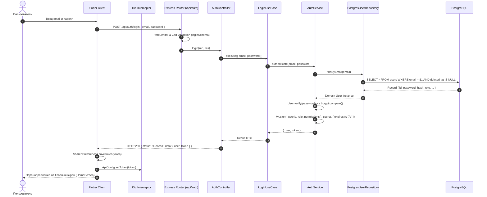
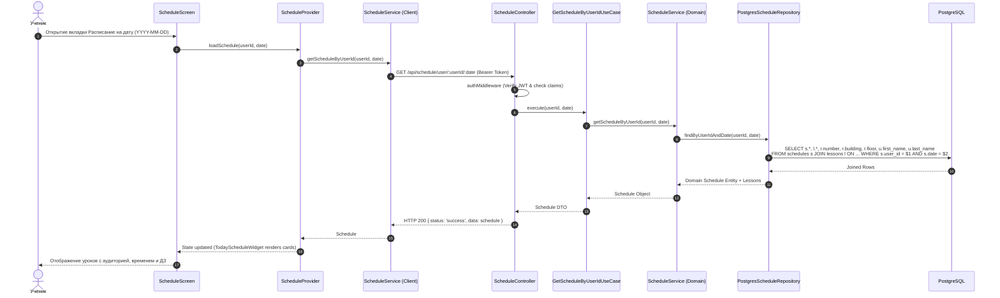
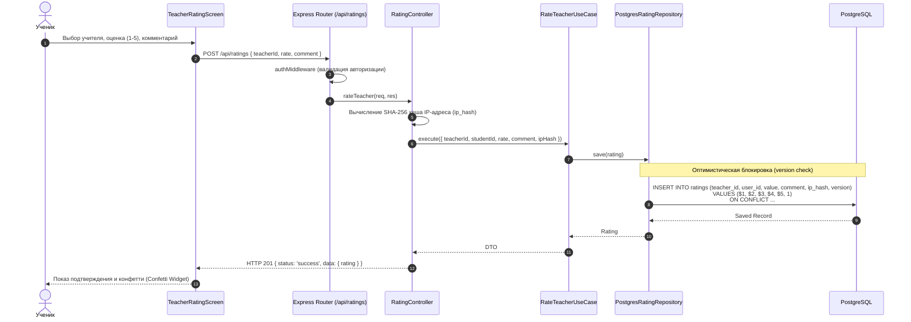

# Архитектура и системный дизайн PrimakovApp

Данный документ описывает внутреннюю структуру, архитектурные паттерны, потоки данных, алгоритмические решения и модель данных образовательного комплекса **PrimakovApp**.

---

## 1. Архитектурный стиль и принципы проектирования

Проект построен на комбинации **Clean Architecture** (Чистая архитектура Роберта Мартина) и **Domain-Driven Design (DDD)** на бэкенде, а также **компонентно-ориентированной реактивной архитектуры** на мобильном клиенте.

### 1.1. Ключевые принципы
1. **Инверсия зависимостей (Dependency Inversion Principle, DIP)**:
   - Внутренние слои (Domain) определяют интерфейсы репозиториев (`IUserRepository`, `IScheduleRepository`, `IRatingRepository`).
   - Внешние слои (Infrastructure) реализуют эти интерфейсы через PostgreSQL (`PostgresUserRepository`, `PostgresScheduleRepository`).
   - Доменная логика и сущности не содержат ссылок на базу данных, SQL-запросы или Express.js.
2. **Слабая связанность и высокая когезия (Low Coupling / High Cohesion)**:
   - Система разделена на 10 автономных ограниченных контекстов (Bounded Contexts):
     1. `Auth` — регистрация, аутентификация, валидация токенов.
     2. `Users` — управление учетными записями, профилями, ролями (RBAC).
     3. `Schedule` — персонализированное расписание учеников и учителей.
     4. `Deadlines` — индивидуальный трекер домашних заданий и сроков сдачи.
     5. `Ratings` — анонимное оценивание преподавателей с защитой от накрутки.
     6. `Stories` — новостные публикации гимназии в формате сторис с медиа-контентом.
     7. `Announcements` — официальные объявления гимназии по категориям.
     8. `Rooms` — навигационный справочник аудиторий кампуса (этажи, корпуса, координаты).
     9. `Requests` — внутренняя тикет-система хозяйственных и IT-заявок.
     10. `Canteen` — меню школьной столовой, калорийность, КБЖУ, аллергены.
3. **Единая ответственность (Single Responsibility Principle, SRP)**:
   - Каждый Use Case инкапсулирует ровно один бизнес-сценарий (например, [RateTeacherUseCase.ts](file:///c:/Users/sasha/ВШЭ/3%20курс/Digital_PM/Primakov_App/backend/src/application/rating/RateTeacherUseCase.ts), [CompleteDeadlineUseCase.ts](file:///c:/Users/sasha/ВШЭ/3%20курс/Digital_PM/Primakov_App/backend/src/application/deadline/CompleteDeadlineUseCase.ts)).

---

## 2. Слоистая модель Backend (Clean Architecture)



### 2.1. Описание слоев
- **[Domain Layer](file:///c:/Users/sasha/ВШЭ/3%20курс/Digital_PM/Primakov_App/backend/src/domain)**:
  - Сущности инкапсулируют фундаментальные бизнес-правила (например, проверка прав [User.hasPermission()](file:///c:/Users/sasha/ВШЭ/3%20курс/Digital_PM/Primakov_App/backend/src/domain/entities/User.ts#L36-L38), валидация интервалов времени занятий, смена пароля).
  - Объекты-значения (Value Objects) гарантируют валидность email (`Email`) и стойкость паролей (`Password`).
- **[Application Layer](file:///c:/Users/sasha/ВШЭ/3%20курс/Digital_PM/Primakov_App/backend/src/application)**:
  - Оркестрирует выполнение бизнес-задач, вызывает сервисы домена и репозитории.
  - Не зависит от HTTP-контекста (req, res), что позволяет легко запускать сценарии в CLI или тестах.
- **[Presentation Layer](file:///c:/Users/sasha/ВШЭ/3%20курс/Digital_PM/Primakov_App/backend/src/presentation)**:
  - Принимает HTTP-запросы, проводит санитайзинг строк, валидирует схемы через `zod`, проверяет JWT-токен и роль RBAC, вызывает Use Case и форматирует JSON-ответ.
- **[Infrastructure Layer](file:///c:/Users/sasha/ВШЭ/3%20курс/Digital_PM/Primakov_App/backend/src/infrastructure)**:
  - Работа с СУБД PostgreSQL через пул `pg.Pool`, выполнение транзакций, версионирование схемы через [migrationRunner.ts](file:///c:/Users/sasha/ВШЭ/3%20курс/Digital_PM/Primakov_App/backend/src/infrastructure/database/migrations/migrationRunner.ts).

---

## 3. Архитектура мобильного клиента (Flutter / Riverpod)



---

## 4. Схемы потоков данных и диаграммы взаимодействия (Mermaid.js)

### 4.1. C4 Диаграмма контекста системы (Context Diagram)



---

### 4.2. Диаграмма последовательности: Авторизация пользователя (Login Flow)



---

### 4.3. Диаграмма последовательности: Получение персонализированного расписания



---

### 4.4. Диаграмма последовательности: Анонимное оценивание преподавателя (OCC + IP Hash)



---

## 5. Модель данных (Entity Relationship Diagram)

```mermaid
erDiagram
    users ||--o{ schedules : "has"
    users ||--o{ deadlines : "creates"
    users ||--o{ ratings : "submits (anonymously)"
    users ||--o{ ratings : "receives (teacher)"
    users ||--o{ stories : "authors"
    users ||--o{ announcements : "authors"
    users ||--o{ story_views : "views"
    users ||--o{ requests : "creates"
    users ||--o{ requests : "assigned_to"

    rooms ||--o{ lessons : "hosts"
    rooms ||--o{ requests : "located_in"

    schedules ||--o{ lessons : "contains"
    stories ||--o{ story_views : "viewed_by"
    canteen_menu ||--o{ menu_items : "includes"

    users {
        uuid id PK
        varchar email UK
        varchar password_hash
        varchar first_name
        varchar last_name
        user_role role "STUDENT | TEACHER | ADMIN | SUPERADMIN"
        varchar group_name "Nullable, eg: 10A"
        boolean is_active
        varchar vk_id
        timestamptz created_at
        timestamptz updated_at
        timestamptz deleted_at "Soft delete flag"
    }

    rooms {
        uuid id PK
        varchar number UK
        varchar name "Nullable"
        varchar building "A | B | Main"
        integer floor
        integer capacity
        decimal latitude
        decimal longitude
        text description
        boolean is_active
        timestamptz created_at
        timestamptz updated_at
    }

    schedules {
        uuid id PK
        uuid user_id FK "Individual student schedule"
        varchar group_id "Optional group fallback"
        date date
        timestamptz created_at
        timestamptz updated_at
    }

    lessons {
        uuid id PK
        uuid schedule_id FK
        varchar subject
        uuid teacher_id FK
        varchar teacher_name
        time start_time
        time end_time
        uuid room_id FK
        varchar room_number
        varchar room_building
        integer room_floor
        boolean has_homework
        text homework_description
        timestamptz created_at
    }

    deadlines {
        uuid id PK
        uuid user_id FK
        varchar title
        text description
        varchar subject
        timestamptz due_date
        deadline_status status "PENDING | COMPLETED | OVERDUE"
        timestamptz completed_at
        timestamptz created_at
        timestamptz updated_at
    }

    ratings {
        uuid id PK
        uuid teacher_id FK
        uuid user_id FK "Optional student ID"
        integer value "1 to 5"
        text comment
        integer version "Optimistic Locking OCC"
        varchar ip_hash "SHA-256 for abuse detection"
        timestamptz created_at
        timestamptz updated_at
    }

    stories {
        uuid id PK
        varchar title
        text description
        text image_url
        text video_url
        varchar link_url "External URL"
        varchar link_text "Button label"
        uuid author_id FK
        timestamptz created_at
        timestamptz expires_at
        timestamptz deleted_at
    }

    story_views {
        uuid id PK
        uuid story_id FK
        uuid user_id FK
        timestamptz viewed_at
    }

    announcements {
        uuid id PK
        varchar title
        text description
        text content
        text image_url
        date date
        announcement_category category "ACADEMIC | EVENT | GENERAL | URGENT"
        uuid author_id FK
        timestamptz created_at
        timestamptz deleted_at
    }

    requests {
        uuid id PK
        request_type type "IT | MAINTENANCE | CLEANING"
        varchar title
        text description
        request_status status "PENDING | IN_PROGRESS | COMPLETED | CANCELLED"
        request_priority priority "LOW | MEDIUM | HIGH | URGENT"
        uuid creator_id FK
        uuid assignee_id FK
        uuid room_id FK
        text notes
        timestamptz created_at
        timestamptz updated_at
        timestamptz completed_at
    }

    canteen_menu {
        uuid id PK
        date date
        meal_type meal_type "BREAKFAST | LUNCH | DINNER | SNACK"
        timestamptz created_at
    }

    menu_items {
        uuid id PK
        uuid menu_id FK
        varchar name
        text description
        varchar category "Soups, Salads, Hot Dishes..."
        integer calories
        decimal protein
        decimal carbs
        decimal fat
        integer weight_grams
        text image_url
        text_array allergens "eg: ['gluten', 'lactose']"
        boolean is_vegetarian
        boolean is_vegan
        decimal price
        integer display_order
    }
```



---

## 6. Обоснование алгоритмических и архитектурных решений

### 6.1. Оптимистическая блокировка (Optimistic Concurrency Control, OCC)
- **Контекст**: Рейтинги преподавателей и агрегация оценок.
- **Проблема**: При одновременной отправке отзывов несколькими пользователями возможны коллизии (race conditions) при обновлении версий агрегатов или дублировании.
- **Решение**: Добавление поля `version` в таблицу `ratings`. При сохранении проверяется текущая версия сущности:
  ```sql
  UPDATE ratings SET value = $1, version = version + 1 WHERE id = $2 AND version = $3;
  ```
  Если затронуто 0 строк, выбрасывается `ConcurrencyException`, сигнализирующий о параллельном изменении.

### 6.2. Анонимизация с защитой от флуда (SHA-256 IP Hashing)
- **Контекст**: Оценивание преподавателей учениками.
- **Проблема**: Студенты должны иметь возможность ставить честные оценки без риска преследования (полная конфиденциальность перед учителем), но система обязана предотвращать накрутку и оскорбительный спам.
- **Решение**:
  - В API рейтинг регистрируется без отображения `studentId` в публичных ответах (`studentId` заменяется на `null` в контроллере).
  - Внутренне в таблице сохраняется необратимый хеш `SHA-256(Client_IP + Salt)`. Это позволяет лимитировать количество оценок от одного физического клиента без хранения персональных данных.

### 6.3. Индивидуальные расписания против групповых
- **Контекст**: Учебный план Гимназии им. Примакова.
- **Проблема**: Ученики старших классов имеют индивидуальные учебные траектории (профили, факультативы, спецкурсы, олимпиадная подготовка), поэтому классическое расписание "10-А класс" не отражает реальность.
- **Решение**: Расписание привязано к конкретному `user_id` ([Schedule.ts](file:///c:/Users/sasha/ВШЭ/3%20курс/Digital_PM/Primakov_App/backend/src/domain/entities/Schedule.ts)). При отсутствии индивидуального расписания контроллер выполняет fallback на расписание группы (`group_id`).

### 6.4. Стратегия мягкого удаления (Soft Deletes)
- **Контекст**: Учетные записи пользователей, сторис, объявления.
- **Решение**: Использование временной метки `deleted_at IS NULL` во всех выборках. Это предотвращает каскадное нарушение целостности внешних ключей в исторических данных (например, уроки, которые вел удаленный учитель, остаются в архиве).

### 6.5. Многоуровневый Rate Limiting
- **Контекст**: Защита от брутфорса и перегрузки сервера.
- **Решение**:
  - `generalRateLimiter`: 100 запросов в минуту на IP для общих эндпоинтов.
  - `authRateLimiter`: 5 попыток в минуту на эндпоинты `/api/auth/login` и `/api/auth/register`.
  - `writeRateLimiter`: 20 запросов в минуту на создание дедлайнов и отправку заявок.

---

## 7. Результаты комплексного аудита и модернизации (ECC Workflow)

В рамках выполнения регламента [AGENTS.md](file:///c:/Users/sasha/ВШЭ/3%20курс/Digital_PM/Primakov_App/AGENTS.md) проект прошел двухфазную модернизацию:

### 7.1. Фаза 1: Бэкенд и безопасность (Clean Architecture & TDD)
1. **Строгое разделение слоев:**
   - Выделены интерфейсы `IRoomRepository`, `IRequestRepository`, `ICanteenMenuRepository` в доменном слое.
   - Разработаны in-memory реализации репозиториев для обеспечения полного автономного тестирования без внешней БД.
2. **Безопасность (AgentShield):**
   - Внедрен статический анализатор `AgentShield` ([AgentShield.ts](file:///c:/Users/sasha/ВШЭ/3%20курс/Digital_PM/Primakov_App/backend/src/shared/security/AgentShield.ts)), гарантирующий отсутствие прямых вызовов БД, SQL-запросов и драйверов (`pg`, `Pool`, `Client`) внутри контроллеров.
   - Срок жизни JWT-токена приведен к 7 дням (`7d`), в payload включены `userId`, `email` и `role`.
3. **Паттерн Result & TDD:**
   - Покрыты интеграционными тестами все существующие маршруты (19 сьютов, 213 тестов, 100% PASS).
   - Обработка ошибок в Use Case возвращает `Result.ok` / `Result.fail`.

### 7.2. Фаза 2: Оживление Flutter-интерфейса (Zero Stubs & Реактивность)
1. **Удаление заглушек:**
   - Заглушки на экранах `services_screen.dart` и `login_screen.dart` удалены. Все переходы ведут на реальные экраны (`ScheduleScreen`, `RegisterScreen`, `CreateRequestScreen`, `CanteenMenuScreen`, `RoomsListScreen`, `AnnouncementsScreen`, `TeacherRatingsScreen`).
2. **Жесты и обратная связь (UX):**
   - На экранах с данными (`HomeScreen`, `DeadlineScreen`, `ScheduleScreen`, `RoomsListScreen`, `AnnouncementsScreen`) внедрен жест pull-to-refresh (`RefreshIndicator`).
   - На кнопках форм реализованы индикаторы загрузки (`CircularProgressIndicator`) и вывод читаемых сообщений об ошибках из бэкенда.
3. **Верификация мобильного клиента:**
   - `flutter analyze`: 0 синтаксических ошибок.
   - `flutter test`: 100% тестов успешно пройдены.

