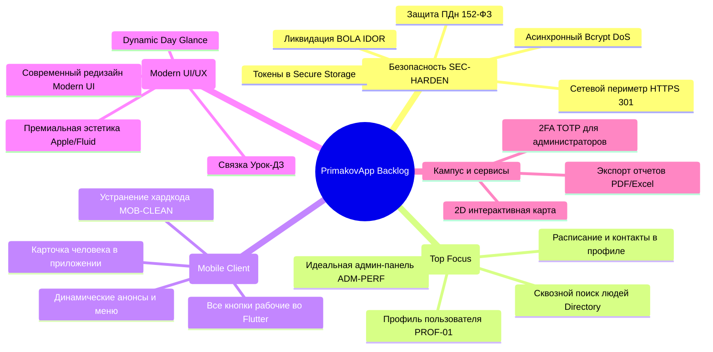

# Матрица функциональности, UI/UX и дорожная карта развития (Feature & UX Matrix & Roadmap)

Документ содержит исчерпывающий перечень возможностей цифровой экосистемы **PrimakovApp** («Гимназия им. Е.М. Примакова»), детальный статус реализации модулей, анализ разрыва между текущим состоянием и требованиями заказчика, реестр улучшений пользовательского опыта (UI/UX), а также единую матрицу приоритизации по методологиям **MoSCoW** и **RICE**.

---

## 1. Концепция продукта и ролевая модель

**PrimakovApp** спроектирован как персональный цифровой ассистент ученика, преподавателя и администрации гимназии. Продукт не ставит целью прямое дублирование государственного журнала МЭШ (оценки за уроки остаются в МЭШ), а решает прикладные задачи школьного дня и объединяет в одном окне расписание, дедлайны, сервисы кампуса, новости и коммуникацию.

### Ролевая матрица доступа (RBAC)

| Роль | Назначение и уровень доступа | Основные пользовательские сценарии |
| :--- | :--- | :--- |
| **`STUDENT`** | Учащийся гимназии | Просмотр личного расписания по классу (10-А, 11-Б), трекинг ДЗ и дедлайнов, анонимная оценка учителей, просмотр меню столовой с КБЖУ, подача заявок в техподдержку, просмотр Stories |
| **`TEACHER`** | Преподаватель / Классный руководитель | Просмотр расписания уроков и консультаций, выставление дедлайнов для своих групп, просмотр меню, отправка заявок на ремонт оборудования |
| **`ADMIN`** | Сотрудник учебной части / IT-отдела / Комбината питания | Доступ к веб-панели управления, управление пользователями, модерация заявок служб, управление расписанием и заменами, **ведение ежедневного меню столовой** |
| **`SUPERADMIN`** | Директорат / Завучи | Полный доступ ко всем модулям, назначение ролей, аудит действий пользователей, экспорт аналитических отчетов |
| **`STAFF`** | Персонал служб (IT, Клининг, Завхоз) | Получение и смена статусов сервисных заявок («В работе», «Выполнено») |

---

## 2. Реестр реализованного функционала (Current State — 100% Ready)

В рамках этапов MVP, Admin Panel и Спринта 1 (v0.4.0) полностью разработаны, протестированы и интегрированы следующие подсистемы:

### 2.1. Клиентская часть (Flutter Mobile + Desktop Web)

| Фича | Платформа | Реализация в коде | Описание функционала | Статус |
| :--- | :---: | :--- | :--- | :---: |
| **Авторизация и сессии** | Mobile / Web | `login_screen.dart` / `LoginModal.tsx` | Вход по корпоративному email и паролю, выпуск JWT токена (TTL: 7 дней), сохранение сессии, переключение серверов (Local / VPS) и Demo-режим | ✅ Готово |
| **Персональное расписание** | Mobile | `schedule_screen.dart` | Выборка уроков по датам для конкретного ученика (`user_id`), отображение кабинета, преподавателя, времени звонков и прикрепленного ДЗ | ✅ Готово |
| **Офлайн-кэш расписания и меню (Hive)** | Mobile | `offline_cache_service.dart`, `schedule_provider.dart`, `canteen_provider.dart` | Локальное хранение расписания и меню на Hive. Мгновенная отрисовка данных без сети, фоновая синхронизация | ✅ Готово (v0.4.0) |
| **Трекер дедлайнов** | Mobile | `deadline_screen.dart` | Создание учебных задач, фильтрация (все / активные / завершенные), отметка выполнения с анимацией конфетти | ✅ Готово |
| **Push-уведомления о дедлайнах (24ч и 2ч)** | Mobile / Backend | `push_notification_service.dart` / `ProcessDeadlineNotificationsUseCase.ts` | Фоновый воркер проверяет сроки сдачи, отправляет пуши за 24 ч и 2 ч. Мобильный клиент парсит срочные алерты и сохраняет их | ✅ Готово (v0.4.0) |
| **Рейтинг преподавателей** | Mobile / Web | `teacher_ratings_screen.dart` / `RatingsView.tsx` | Анонимное оценивание учителей (1–5 звезд) с комментариями, защита от накрутки через IP-хеш, модерация отзывов администрацией, resilient fallback | ✅ Готово |
| **Истории гимназии (Stories)** | Mobile | `story_viewer_screen.dart` | Медиа-анонсы с поддержкой изображений, переходом по внешним гиперссылкам и фиксацией факта просмотра в БД | ✅ Готово |
| **Меню столовой** | Mobile | `canteen_menu_screen.dart` | Просмотр блюд на сегодня и на выбранную дату: подсчет калорийности, КБЖУ, бейджи аллергенов и вегетарианских позиций | ✅ Готово |
| **Кампусный навигатор** | Mobile | `rooms_list_screen.dart` | Справочник аудиторий гимназии с группировкой по корпусам, этажам и GPS/координатам | ✅ Готово |
| **Сервисные заявки (Helpdesk)** | Mobile / Web | `create_request_screen.dart` / `RequestsView.tsx` | Подача заявок на IT-поддержку, хозяйственный ремонт или клининг аудиторий с указанием приоритета (Low/Medium/High/Urgent) | ✅ Готово |
| **Админ-дашборд (Overview)** | Web | `DashboardView.tsx` | Бенто-сетка ключевых метрик гимназии (ученики, учителя, индекс CSI 4.88, посещаемость), график недельной активности, алерты | ✅ Готово |
| **Управление пользователями & Карточка профиля** | Web | `UsersView.tsx`, `UserProfileModal.tsx`, `EditUserModal.tsx` | Поиск, фильтры по ролям, пагинация, модальное окно добавления/редактирования (ДР, телефон, telegram), детальный профиль с расписанием дня | ✅ Готово (v0.5.5) |
| **Справочник людей и сквозной поиск (Campus Directory)** | Mobile | `people_directory_screen.dart`, `user_profile_detail_screen.dart`, `services_screen.dart` | Единый сквозной поиск гимназистов и учителей в шапке «Сервисы», карточка человека с ДР, возрастом, расписанием и быстрой связью | ✅ Готово (v0.5.5) |
| **Расширенный профиль пользователя** | Mobile | `profile_screen.dart`, `edit_profile_screen.dart` | Просмотр и редактирование личных данных (ДР, телефон, telegram, email, класс), синхронизация с бэкендом | ✅ Готово (v0.5.5) |
| **Управление расписанием и заменами** | Web | `ScheduleView.tsx` | Справочник учебных дисциплин, привязка преподавателей к предметам, добавление уроков в расписание классов и оперативная замена учителей | ✅ Готово (v0.4.0) |
| **Билингвальность Admin Web & Mobile (RU / EN)** | Mobile / Web | `LanguageContext.tsx` / `app_localizations.dart`, `locale_provider.dart` | Полная поддержка английского языка во всех аспектах: веб-панель (дашборд, расписание, пансион, столовая, кубок домов, сторис, модальные окна), мобильное приложение (Day Glance, Bento-карточки, дедлайны, меню, профиль, вход) | ✅ Готово (v0.6.5) |
| **Фирменная дизайн-система Primakov Design System** | Mobile | `app_colors.dart`, `app_typography.dart`, `primakov_card.dart`, `primakov_badge.dart` | Редизайн без дефолтного Material: благородная бордовая палитра (#8C251C, #701C14), микроанимации flutter_animate, иконки lucide_icons, шрифты Manrope/Inter, адаптивные светлая и темная темы | ✅ Готово (v0.6.5) |
| **Успеваемость и GPA Simulator** | Mobile | `grades_screen.dart`, `grades_provider.dart` | Бенто-сводка среднего балла, список предметов с весами оценок (1/1.5/2), интерактивный симулятор прогноза GPA, оффлайн-кэш Hive | ✅ Готово (v0.6.0) |
| **Импорт ведомостей МЭШ (CSV)** | Web / Backend | `ImportMeshGradesModal.tsx` / `AdminImportMeshGradesUseCase.ts` | Drag-and-drop CSV парсер ведомостей МЭШ/ЭЖД, сопоставление учеников и предметов, расчет средневзвешенного балла, пакетное сохранение | ✅ Готово (v0.6.0) |
| **Лига Домов (House Cup)** | Mobile / Web | `house_standings_screen.dart` / `HousesView.tsx` | Турнирная таблица 4 Домов (Север, Юг, Восток, Запад), начисление баллов по 5 категориям, аудит транзакций в реальном времени, оффлайн-кэш Hive | ✅ Готово (v0.6.0) |
| **Жизнь в пансионе (Boarding Life)** | Mobile / Web | `boarding_pass_screen.dart` / `BoardingView.tsx` | Вечерний чекин с геолокацией, подача заявлений на выезд на выходные с QR-пропуском, ведомость переклички и модерация выездов администрацией | ✅ Готово (v0.6.0) |
| **Полный контроль Историй (Stories CRUD)** | Web / Backend | `StoriesView.tsx` / `CreateStoryUseCase.ts`, `UpdateStoryUseCase.ts`, `DeleteStoryUseCase.ts` | Публикация историй с медиа, коротким текстом, интерактивной ссылкой и текстом кнопки, готовые пресеты, редактирование, удаление | ✅ Готово (v0.6.0) |
| **Интерактивные Объявления (Detail Sheet)** | Mobile / Web | `announcements_screen.dart` / `AnnouncementsView.tsx` | Apple-style всплывающее контекстное окно с полным текстом и копированием по тапу на карточку, модальное редактирование в Web Admin | ✅ Готово (v0.6.0) |
| **Современный плеер Stories** | Mobile | `story_viewer_screen.dart` | Полноэкранный плеер в стиле Telegram/Instagram: Frosted Glass плашка снизу, кнопка перехода по ссылке (url_launcher), tap-and-hold пауза, смахивание вниз | ✅ Готово (v0.6.0) |
| **Тотальный журнал аудита (Audit Trail & Security Log)** | Web / Backend | `AuditLogView.tsx` / `auditMiddleware.ts`, `PostgresAuditRepository.ts` | Перехват всех мутирующих запросов (POST/PUT/DELETE/PATCH), маскирование паролей, асинхронная запись в `audit_logs`, фильтрация и инспекция в веб-панели | ✅ Готово (v0.7.0) |
| **Контроль коллизий расписания (Schedule Collision Guard)** | Web / Backend | `ScheduleCollisionGuard.ts`, `AddLessonToScheduleUseCase.ts`, `SubstituteTeacherUseCase.ts` | Тройная проверка при составлении и замене: доступность учителя, незанятость аудитории, отсутствие накладок у учебной группы | ✅ Готово (v0.7.0) |
| **Автосинхронизация ДЗ в Дедлайны (Auto Homework Sync)** | Backend | `AutoHomeworkSyncUseCase.ts` | Автоматическое создание учебных дедлайнов ученикам класса при назначении ДЗ к уроку, умный расчет даты сдачи к следующему уроку предмета | ✅ Готово (v0.7.0) |
| **Сторожевой таймер заявок (SLA Watchdog & Auto-Routing)** | Backend | `ServiceDeskSLAWorker.ts`, `TicketAutoRouter.ts` | Фоновый воркер контроля регламентных сроков техподдержки (2ч URGENT, 4ч HIGH, 24ч MEDIUM, 48ч LOW), автофиксация просрочки и маршрутизация по службам | ✅ Готово (v0.7.0) |
| **Контроль пансиона и аллергий (Curfew & Allergen Safety)** | Backend | `BoardingCurfewWorker.ts`, `AllergenSafetyGuard.ts` | Вечерний сторож комендантского часа пансиона (21:30) с алертом о несанкционированном отсутствии, стоп-фильтр аллергенов в столовой | ✅ Готово (v0.7.0) |
| **Комплексный сидинг данных и Unmocking (Synthetic Data)** | Backend / DB | `029_SeedComprehensiveSyntheticData.sql` | 14 дней расписаний с ДЗ и аудиториями, оценки по триместрам, транзакции Домов, меню столовой с КБЖУ, заявки Helpdesk с SLA, отзывы учителей, пансион | ✅ Готово (v0.7.5) |
| **Самовосстанавливающаяся схема миграций (Self-Healing DDL)** | Backend / DB | `migrationRunner.ts`, `028_...sql`, `029_...sql` | Автоматический каскадный сброс и пересоздание зависимых представлений (VIEW), динамическое снятие FK, безопасное приведение типов, парсер dollar-quoting | ✅ Готово (v0.7.5) |

---

### 2.2. Серверная архитектура и база данных (Clean Architecture)

- **Ядро и сценарии (Use Cases)**:
  - 22 изолированных контекста в `backend/src/application/`.
  - Модуль автоматизации и контроля: `ServiceDeskSLAWorker`, `BoardingCurfewWorker`, `AllergenSafetyGuard`, `ScheduleCollisionGuard`, `AutoHomeworkSyncUseCase`, `GetAuditLogsUseCase`.
  - Модуль успеваемости: `AdminImportMeshGradesUseCase`, `GetStudentGradesUseCase`.
  - Модуль Лиги Домов: `GetHouseCupStandingsUseCase`, `AwardHousePointsUseCase`.
  - Модуль пансиона: `BoardingCheckInUseCase`, `GetStudentBoardingStatusUseCase`, `CreateWeekendLeaveRequestUseCase`, `GetBoardingRosterUseCase`, `UpdateLeaveRequestStatusUseCase`.
  - Модуль историй: `GetStoriesUseCase`, `MarkStoryAsViewedUseCase`, `CreateStoryUseCase`, `UpdateStoryUseCase`, `DeleteStoryUseCase`.
  - Модуль объявлений: `GetAnnouncementsUseCase`, `GetAnnouncementByCategoryUseCase`, `CreateAnnouncementUseCase`, `UpdateAnnouncementUseCase`, `DeleteAnnouncementUseCase`.
  - Модуль профилей и справочника: `GetUserProfileUseCase`, `SearchUsersDirectoryUseCase`, `UpdateProfileUseCase`.
  - Модуль расписания и замен: `GetAllSchedulesAdminUseCase`, `SubstituteTeacherUseCase`, `AddLessonToScheduleUseCase`.
  - Модуль предметов и кафедр: `CreateSubjectUseCase`, `GetSubjectsUseCase`, `DeleteSubjectUseCase`, `AssignTeacherSubjectUseCase`, `RemoveTeacherSubjectUseCase`, `GetTeacherSubjectsUseCase`.
  - Модуль пуш-нотификаций: `ProcessDeadlineNotificationsUseCase`, `DeadlineNotificationWorker`.
  - Модуль администрирования: `AdminGetDashboardStatsUseCase`, `AdminGetUsersUseCase`, `AdminCreateUserUseCase`, `AdminUpdateUserUseCase`, `AdminUpdateUserStatusUseCase`, `AdminDeleteUserUseCase`, `AdminBatchImportUsersUseCase`.
- **База данных PostgreSQL**:
  - 30 версионированных SQL-миграций (`001` – `030`).
  - Миграция `028`: таблица `requests` с полями `sla_deadline_at`, `sla_breached`, `priority`, `type`, `creator_id`, `assignee_id` и алиас `service_requests`.
  - Миграция `019`: таблица `audit_logs` для сквозного аудита мутирующих операций.
  - Миграция `026`: модуль успеваемости (`grades` с полями student_id, subject_id, value, weight, period, topic, date).
  - Миграция `027`: Лига Домов и Пансион (`house_point_transactions`, `boarding_checkins`, `weekend_leave_requests`, колонки в `users`: `house`, `is_boarding`, `room_number`).
  - Мягкое удаление (`deleted_at`), аудит изменений (`audit_logs`), системные параметры (`system_settings`).
- **Контроль качества**:
  - **364 автоматизированных теста Jest на бэкенде** (100% прохождение, 43 тестовых сьюта).
  - **54 автоматизированных теста во Flutter** (14 сьютов: Unit, Widgets, Hive Offline Cache, Localization, Navigation, Primakov Design System).
  - Строгий TDD (Test-Driven Development) подход.

---

## 3. Реестр будущих фич и улучшений UI/UX (Backlog)

### 3.0. Комплексный пакет усиления кибербезопасности и защиты данных (SEC-HARDEN)

Пакет мер, сформированный по результатам независимого аудита безопасности (`AgentShield`, SAST-сканирование исходного кода, анализ сетевого периметра).

#### 🔴 SEC-01: Защита сетевого периметра и принудительный HTTPS (P0)
* **Проблема**: Порт `3000` проброшен наружу в интернет в `docker-compose.prod.yml`, что позволяет злоумышленникам подключаться к Express в обход Nginx, обходя HTTPS и подделывая `X-Forwarded-For` для сброса лимитов `express-rate-limit`. На 80-м порту Nginx отсутствует 301-редирект на HTTPS, а мобильный клиент по умолчанию обращается по незашифрованному `http://primakov.ddns.net:3000/api`.
* **Решение**:
  - `docker-compose.prod.yml`: удалить маппинг `3000:3000` наружу, оставить бэкенд исключительно во внутренней сети `primakov_net` с доступом только от Nginx.
  - `nginx/conf.d/app.conf`: на 80-м порту настроить безусловный редирект: `return 301 https://$host$request_uri;` (за исключением ACME-челленджа Certbot).
  - `flutter/lib/config/api_config.dart`: перевести дефолтный базовый URL на `https://primakov.ddns.net/api`.
  - Обновление руководства по развертыванию `docs/DEPLOYMENT_GUIDE.md`.

#### 🔴 SEC-02: Ликвидация уязвимостей BOLA / IDOR в API дедлайнов и сервисных заявок (P0 — Strict TDD)
* **Проблема**: Все маршруты `deadlineRoutes.ts` работают под `optionalAuthMiddleware` и доверяют параметру `?userId=`, позволяя читать и модифицировать домашние задания любого учащегося. `completeDeadline` завершает чужие дедлайны без проверки автора. В `requestRoutes.ts` любой учащийся может просматривать все активные заявки школы (`/active`, `/type/:type`) и менять их статус (`/:id/status`).
* **Решение**:
  - `deadlineRoutes.ts`: перевести все маршруты на обязательный `authMiddleware`.
  - `DeadlineController.ts`: извлекать идентификатор пользователя строго из `req.user.userId`. Запретить подмену `userId` обычными студентами.
  - `completeDeadline`: проверять владение дедлайном (`deadline.userId === req.user.userId`) перед переключением статуса, возвращать `403 Forbidden` при попытке закрыть чужой дедлайн.
  - `requestRoutes.ts`: ограничить доступ к эндпоинтам `/active` и `/type/:type` только для персонала (`ADMIN`, `SUPERADMIN`, `TEACHER`). Метод `PATCH /:id/status` разрешать только администрации/мастерам либо автору заявки.
  - Покрытие интеграционными тестами в Jest (`tests/api/deadline.test.ts`, `tests/api/request.test.ts`).

#### 🟠 SEC-03: Защита персональных данных (152-ФЗ / GDPR) и анонимизация отзывов (P1)
* **Проблема**: Эндпоинт `GET /api/ratings?teacherId=...` раскрывает `studentId` каждого учащегося, оставившего отзыв об учителе. Эндпоинт `GET /api/users/:id/profile` возвращает любому залогиненному студенту личный телефон, Telegram, дату рождения и поурочное расписание с кабинетами любого другого ученика.
* **Решение**:
  - `RatingController.getRatings`: исключать поле `studentId` из ответа для всех пользователей кроме `ADMIN` / `SUPERADMIN` (гарантия анонимности студенческих отзывов).
  - `GetUserProfileUseCase.ts`: разграничить контекст просмотра (`viewerRole`, `viewerUserId`). Если профиль запрашивает другой ученик, маскировать поля `phone`, `telegram`, `birthDate` и не отдавать персональное расписание дня `todayLessons` (доступно только самому ученику и сотрудникам школы).
  - Покрытие юнит-тестами в `tests/unit/UserProfileAndDirectory.test.ts`.

#### 🟠 SEC-04: DoS-защита Event Loop, безопасный JWT и маскирование ошибок (P1)
* **Проблема**: Хеширование и сверка паролей в `Password.ts` используют синхронные `bcrypt.compareSync` и `hashSync`, блокирующие главный поток Node.js на 80–100 мс и создающие уязвимость отказа в обслуживании (Event Loop Starvation). В `jwt.ts` присутствует статический fallback-секрет. `errorHandlerMiddleware` раскрывает названия таблиц и SQL-ошибки клиенту при сбоях 500.
* **Решение**:
  - `Password.ts`, `User.ts`, `AuthService.ts`: внедрить асинхронные методы `compareAsync` и `createAsync` (`bcrypt.compare`, `bcrypt.hash`) для разгрузки главного потока через libuv.
  - `jwt.ts`: выбрасывать фатальную ошибку инициализации при отсутствии `JWT_SECRET` вместо использования резервного ключа.
  - `errorHandlerMiddleware.ts`: при ошибках 500 логировать стек на сервере, а клиенту отдавать безопасную маскированную заглушку `{"error": {"code": "INTERNAL_ERROR", "message": "Internal server error"}}`.
  - `cors.ts`: исключить подстановку wildcard `*` при активном флаге `credentials: true`.

#### 🟡 SEC-05: Мобильная безопасность и гигиена репозитория (P2)
* **Проблема**: Dio interceptor во Flutter выводит Bearer JWT токен в консоль и Logcat (`print('🔑 Headers: ${options.headers}')`). Токен хранится в открытом виде в `SharedPreferences`. В корне бэкенда присутствуют тестовые скрипты с зашитыми паролями `primakov`.
* **Решение**:
  - `flutter/lib/config/api_config.dart`: удалить логирование авторизационных заголовков в консоль.
  - Сформировать план перевода токенов во Flutter на зашифрованное хранилище `flutter_secure_storage` (Keychain / Keystore).
  - Очистить служебные скрипты `backend/*.js` от жестко закодированных паролей базы данных.

---

### 3.1. Задачи наивысшего приоритета (Top Priority Initiatives)

#### 🔴 TOP-1: Сквозная обработка ошибок с дружелюбным UI-отображением (ERR-01 / Global Error Feedback)
* **Проблема**: При сбоях сети, серверных ошибках 500, истечении токена 401 или невалидном вводе пользователь сейчас рискует столкнуться либо с тихим падением (тихий лог в консоль), либо с бесконечным лоадером. Это разрушает доверие к приложению.
* **Решение**:
  - **Глобальные всплывающие Toast / SnackBar уведомления**: цветовая схема статусов (Success — зеленый, Warning — янтарный, Error — рубиновый `#BA1A1A`), понятные формулировки на русском языке («Не удалось подключиться к серверу», «Преподаватель уже занят в этот временной слот»).
  - **Error Boundaries и экраны восстановления**: аккуратные карточки ошибок с понятным объяснением и кнопкой *«Повторить попытку»* вместо белого экрана.
  - **Инлайн-валидация форм**: мгновенная подсветка обязательных полей при добавлении уроков, замен или пользователей с подсказками до отправки.
  - **Информативные пустые состояния (Empty States)**: аккуратные иллюстрации («На выбранный день уроков нет», «Все дедлайны выполнены») вместо пустых белых блоков.

#### 🔴 TOP-2: Генерация реалистичных мок-данных большого объема (SEED-01 / 100+ Студентов и Учителей)
* **Проблема**: В базе данных и моках мало тестовых пользователей, а расписание завязано на сырые UUID (`5a5c19fb-aecf-4df7-a4a2-d83311cc6299`), как зафиксировано на скриншоте веб-админки. Это мешает тестированию фильтров, пагинации и восприятию расписания.
* **Решение**:
  - Генерация **100+ учащихся**, распределенных по 10+ классам и параллелям:
    - Начальная школа: `1-А`, `2-Б`, `4-А`
    - Средняя школа: `5-А`, `6-Б`, `7-А`, `8-В`, `9-А`, `9-Б`
    - Старшая школа: `10-А` (соц-эк), `10-Б` (физ-мат), `11-А` (гум), `11-Б` (IT/IB).
    - Реалистичные русскоязычные ФИО, корпоративные адреса `@primakov.school`, классы, а также история оценок и дедлайнов.
  - Генерация **25+ преподавателей**, распределенных по кафедрам (Кафедра математики, Кафедра словесности, Кафедра естественных наук, Кафедра иностранных языков, Кафедра IT и робототехники, Кафедра физкультуры).
  - **Человекочитаемые названия классов в расписании**: замена технических UUID в фильтрах и заголовках расписания на читаемые бейджи классов (`10-А`, `11-Б`) как в админке, так и во Flutter.

#### 🔴 TOP-3: Модуль управления меню столовой в веб-админке (ADM-01 / Canteen Web Management)
* **Проблема**: Мобильное приложение уже умеет отображать КБЖУ, аллергены и категории меню, но в веб-админке отсутствует интерфейс для шеф-повара и комбината питания. Меню невозможно создать или скорректировать через веб-интерфейс.
* **Решение**:
  - Новый пункт навигации в `Sidebar.tsx`: **«Столовая и меню»** (иконка `restaurant_menu`).
  - Управление меню на неделю с разделением по приемам пищи: *Завтрак*, *Обед*, *Полдник*, *Ужин*.
  - Создание и редактирование карточки блюда:
    - Название, описание, категория (Супы, Горячее, Гарниры, Салаты, Напитки, Выпечка).
    - КБЖУ: калорийность (ккал), белки, жиры, углеводы, вес порции (г), цена.
    - Бейджи аллергенов: *Глютен*, *Лактоза*, *Орехи*, *Рыба*, *Яйца*.
    - Теги: *Вегетарианское*, *Халяль*, *Постное*, *Без сахара*.
  - Функция клонирования рациона на следующую неделю (Copy week menu).
  - Эндпоинты в backend Clean Architecture: CRUD для рационов и блюд столовой.

---

### 3.2. Функциональный бэклог (Core Features)

1. **Детальный профиль пользователя и контакты (PROF-01)**:
   - Расширение сущности пользователя: дата рождения (`birth_date`), рабочий/личный телефон (`phone`), Telegram (`telegram`), привязанный класс или кафедра.
   - Детальная карточка профиля в Admin Web (`UserProfileModal`) и мобильном приложении (`UserProfileDetailScreen`).
   - Отображение персонального расписания уроков на день в карточке пользователя.
2. **Единый кампусный поиск людей (DIR-01 / Campus People Directory)**:
   - Сквозной поиск учащихся и преподавателей по имени, фамилии, классу и кафедре как в веб-админке, так и во Flutter.
   - Индикация дней рождения: праздничный бейдж 🎂 для именинников недели.
   - Быстрые контакты в 1 тап (`url_launcher`: звонок, email, telegram).
3. **Ликвидация захардкоженных данных и неработающих кнопок (MOB-CLEAN)**:
   - Замена мок-провайдеров новостей (`mockNewsListProvider`) и столовой (`mockCafeteriaProvider`) во Flutter на реальные сервисы.
   - Устранение хардкода `'user-1'`, привязка всех экранов к авторизованному контексту.
   - Проверка и обеспечение 100% работоспособности каждой кнопки и перехода в мобильном клиенте.
4. **Современный визуальный редизайн UI/UX (UI-MODERN)**:
   - Осовременивание мобильного приложения и веб-панели (эстетика Apple Human Interface / Glassmorphism / Fluid School Design).
   - Обновленные Bento-карточки, утонченные разделители, микроанимации и плавная смена состояний.
5. **Групповые дедлайны от преподавателей (F-01)**:
   - Создание ДЗ преподавателем одновременно для всего класса или подгруппы.
   - Синхронизация с личными трекерами дедлайнов учащихся группы.
6. **2D векторная интерактивная карта кампуса (F-02)**:
   - Векторные интерактивные схемы этажей гимназии с поиском кабинетов, столовой и спорткомплекса.
7. **Экспорт аналитических отчетов PDF / Excel в админке (F-03)**:
   - Формирование сводок для завучей: посещаемость занятий, активность подачи заявок, рейтинг кафедр.
8. **Сброс пароля через корпоративный Email (F-04)**:
   - Отправка безопасных одноразовых ссылок сброса пароля без привлечения IT-отдела.
9. **Двухфакторная аутентификация (2FA / TOTP) (F-05)**:
   - Защита учетных записей администраторов через Google Authenticator / Яндекс Ключ.
10. **ИИ-детектор очереди столовой по камере (F-06)**:
   - Интеграция с потоком камеры обеденного зала (OpenCV/YOLO) с выводом статуса загруженности.
11. **Telegram-бот дублирования оповещений (F-07)**:
   - Трансляция важных общешкольных анонсов и замен в родительский канал.

---

### 3.3. Реестр улучшений пользовательского интерфейса и эргономики (UI/UX Backlog)

* **UI-01: Dynamic Day Glance (Time-Aware баннер дня на Главной во Flutter)**:
  - Верхний адаптивный смарт-виджет, меняющийся по времени суток (*«До 1-го урока 15 мин • Алгебра, Каб. 314»* утром, *«Большая перемена • Меню столовой»* в обед, *«Дедлайны на завтра»* вечером).
* **UI-02: Центр уведомлений и колокольчик (In-App Notification Center во Flutter)**:
  - Иконка «Колокольчик» с бейджем непрочитанных в шапке -> шторка/экран с историей уведомлений (дедлайны, замены уроков, статусы тикетов).
* **UI-03: Мягкий индикатор офлайн-статуса и синхронизации (Soft Offline Badge во Flutter)**:
  - Аккуратный анимированный чип под AppBar: *«Данные из кэша (обновлено сегодня в 08:15)»* + кнопка быстрого обновления.
* **UI-04: Контекстная связка «Урок ↔ Дедлайн» в расписании (Contextual Homework во Flutter)**:
  - На карточке урока в сетке расписания бейдж *«Есть ДЗ к сдаче»*. Тап по уроку сразу показывает прикрепленный дедлайн.
* **UI-05: Интерактивная матрица расписания (Timetable Matrix Grid View в Admin Web)**:
  - Полноэкранная интерактивная шахматка («Классы по горизонтали, Слоты уроков 1–7 по вертикали») с цветовым кодированием кафедр.
* **UI-06: Защита от конфликтов преподавателей (Collision Detection в Admin Web)**:
  - Валидация занятости учителей при замене с подсветкой статуса *«Свободен»* или *«Ведет урок в 9Б, каб. 204»*.
* **UI-07: Тактильный отклик и микроинтеракции (Haptic Feedback & Micro-interactions во Flutter)**:
  - Подключение `HapticFeedback.lightImpact()` при отметке чекбокса дедлайна, свайп-действия в списках.
* **UI-08: Командная строка быстрого поиска (Global Command Palette `Cmd+K` в Admin Web)**:
  - Всплывающая строка `Cmd+K` / `Ctrl+K` для мгновенного перехода в любой раздел, поиска карточки ученика или преподавателя.
* **UI-09: Полноценный Deep Linking для Push-уведомлений**:
  - Прямой переход по ссылке пуша (`/deadlines/:id`, `/schedule/:date`) в детальную карточку конкретной задачи или урока.

---

## 4. Единая матрица приоритизации (MoSCoW & RICE)

Для объективной приоритизации объединенного бэклога применен фреймворк **RICE Scoring**:
$$\text{RICE Score} = \frac{\text{Reach (Охват чел/мес)} \times \text{Impact (Влияние)} \times \text{Confidence (Уверенность)}}{\text{Effort (Трудозатраты в днях)}}$$

- **Reach**: 1200 — все гимназисты, 1100 — мобильные пользователи, 900 — средняя/старшая школа, 200 — администраторы и учителя, 50 — завучи.
- **Impact**: 5 — критическое/колоссальное, 4 — высокое, 3 — умеренное, 2 — небольшое, 1 — минимальное.
- **Confidence**: 100% — полное ТЗ / готовый прототип, 90% — отработанный паттерн, 80% — стандартная разработка, 50% — R&D гипотеза.
- **Effort**: человеко-дни разработки и тестирования.

### Сводная таблица RICE (актуализированные приоритеты)

| № | ID | Инициатива / Фича | Тип | Reach | Impact | Conf | Effort | RICE | MoSCoW | Спринт реализации |
| :-: | :---: | :--- | :---: | :---: | :---: | :---: | :---: | :---: | :---: | :---: |
| **—** | *ADM-HEALTH* | *[Реализовано] Product Health Dashboard: System Pulse, DAU, SLA заявок, CSI, Alerts* | Core/Admin | 200 | 5 | 95% | 1.5 | *633* | 🔴 *Must Have* | *Выполнено (v0.6.0)* |
| **—** | *ADM-BRAND* | *[Реализовано] Брендинг Primakov School, логотип, чистка хедера и сайдбара* | Core/Admin | 200 | 4 | 100% | 0.5 | *800* | 🔴 *Must Have* | *Выполнено (v0.6.0)* |
| **—** | *ADM-MOB-WEB*| *[Реализовано] Адаптивная мобильная веб-админка (Drawer + Bottom Nav Bar)* | UI/UX | 300 | 5 | 90% | 1.0 | *1350* | 🔴 *Must Have* | *Выполнено (v0.6.0)* |
| **—** | *MOB-CLEAN* | *[Реализовано] Ликвидация хардкода во Flutter, 2x3 сетка и рабочие кнопки* | Core/Mobile | 1100 | 4 | 95% | 1.0 | *4180* | 🔴 *Must Have* | *Выполнено (v0.5.5)* |
| **—** | *PROF-01* | *[Реализовано] Профиль пользователя (ДР, контакты, расписание)* | Core/Platform | 1200 | 5 | 95% | 1.5 | *3800* | 🔴 *Must Have* | *Выполнено (v0.5.5)* |
| **—** | *DIR-01* | *[Реализовано] Campus Directory (Сквозной поиск учащихся и учителей)* | Core/UX | 1200 | 4 | 90% | 1.5 | *2880* | 🔴 *Must Have* | *Выполнено (v0.5.5)* |
| **—** | *ADM-PERF* | *[Реализовано] Идеальная админ-панель (Карточка профиля, 0 заглушек)* | Core/Admin | 200 | 5 | 95% | 1.5 | *633* | 🔴 *Must Have* | *Выполнено (v0.5.5)* |
| **1** | **SEC-HARDEN** | **Комплексное усиление кибербезопасности (HTTPS, BOLA/IDOR, 152-ФЗ, DoS)** | Security/Core | 1200 | 5 | 95% | 2.0 | **2850** | 🔴 **Must Have** | **Спринт 4.5 (v0.6.5 — БЛИЖАЙШИЙ)** |
| **2** | **UI-MODERN** | **Современный премиальный редизайн UI/UX (Mobile & Web)** | UI/UX | 1200 | 5 | 90% | 2.5 | **2160** | 🔴 **Must Have** | **Спринт 4 (v0.6.0 — В ФОКУСЕ)** |
| **—** | *SEED-01* | *[Реализовано] Мок-данные 100+ студентов, 25+ учителей, читаемые классы* | Core/Data | 1200 | 4 | 100% | 1.0 | *4800* | 🔴 *Must Have* | *Выполнено (v0.4.5)* |
| **—** | *UI-07* | *[Реализовано] Тактильный отклик (Haptic) и микроинтеракции* | UI/UX | 1100 | 2 | 90% | 0.5 | *3960* | 🔴 *Must Have* | *Выполнено (v0.4.5)* |
| **—** | *ERR-01* | *[Реализовано] Сквозная обработка ошибок с UI-отображением (Toasts/Retry)* | UI/UX | 1200 | 5 | 95% | 1.5 | *3800* | 🔴 *Must Have* | *Выполнено (v0.4.5)* |
| **—** | *UI-03* | *[Реализовано] Мягкий индикатор офлайн-кэша и синка* | UI/UX | 1100 | 3 | 95% | 1.0 | *3135* | 🔴 *Must Have* | *Выполнено (v0.4.5)* |
| **—** | *LOC-EN* | *[Реализовано] Английская локализация (Bilingual RU/EN во Flutter и Admin Web)* | UI/UX | 1200 | 4 | 95% | 2.0 | *2280* | 🔴 *Must Have* | *Выполнено (v0.5.0)* |
| **—** | *UI-02* | *[Реализовано] Центр уведомлений (In-App Bell & History)* | UI/UX | 1200 | 4 | 90% | 2.0 | *2160* | 🔴 *Must Have* | *Выполнено (v0.4.5)* |
| **—** | *ADM-01* | *[Реализовано] Модуль меню столовой в веб-админке (Canteen Web)* | Core/Admin | 1100 | 4 | 90% | 2.0 | *1980* | 🔴 *Must Have* | *Выполнено (v0.4.5)* |
| **—** | *ADM-CTRL* | *[Реализовано] Расширенное управление сущностями школы* | Core/Admin | 200 | 5 | 95% | 2.5 | *456* | 🔴 *Must Have* | *Выполнено (v0.5.0)* |
| **—** | *UI-05* | *[Реализовано] Интерактивная матрица расписания (Matrix Grid View) в Web* | UI/UX | 200 | 4 | 85% | 3.0 | *226* | 🟡 *Should Have* | *Выполнено (v0.5.0)* |
| **2** | **UI-01** | **Dynamic Day Glance (Time-Aware баннер дня)** | UI/UX | 1200 | 4 | 85% | 2.0 | **2040** | 🔴 **Must Have** | **Спринт 4 (v0.6.0)** |
| **3** | **UI-04** | **Контекстная связка «Урок ↔ Дедлайн»** | UI/UX | 1000 | 3 | 90% | 1.5 | **1800** | 🔴 **Must Have** | **Спринт 4 (v0.6.0)** |
| **4** | **UI-09** | **Deep Linking для push-уведомлений в карточку** | UI/UX | 1200 | 3 | 85% | 2.0 | **1530** | 🟡 **Should Have** | **Спринт 4 (v0.6.0)** |
| **5** | **F-01** | **Групповые дедлайны от преподавателей** | Core | 900 | 4 | 85% | 3.0 | **1020** | 🟡 **Should Have** | **Спринт 4 (v0.6.0)** |
| **6** | **F-02** | **2D интерактивная карта этажей кампуса** | Core | 1200 | 3 | 75% | 6.0 | **450** | 🟡 **Should Have** | **Спринт 5 (v1.0.0)** |
| **7** | **F-04** | **Сброс пароля через корпоративный Email** | Core | 300 | 3 | 90% | 2.0 | **405** | 🟡 **Should Have** | **Спринт 5 (v1.0.0)** |
| **8** | **UI-08** | **Command Palette (`Cmd+K`) в Admin Web** | UI/UX | 150 | 3 | 80% | 1.5 | **240** | 🟡 **Should Have** | **Спринт 5 (v1.0.0)** |
| **9** | **F-03** | **Экспорт отчетов PDF / Excel в админке** | Core | 50 | 4 | 95% | 2.0 | **95** | 🟡 **Should Have** | **Спринт 5 (v1.0.0)** |

---

## 5. Дорожная карта релизов (Release Roadmap)

```mermaid
timeline
    title Дорожная карта развития PrimakovApp (Core + UI/UX)
    section v0.4.0 (Выполнено)
        Офлайн-кэш Hive : Мгновенное расписание и меню без сети
        Push-уведомления : Воркер алертов дедлайнов за 24ч и 2ч
        Управление в Web : Модуль расписания, предметов и замен
    section v0.4.5 (Выполнено)
        Надежность UI : Сквозная обработка ошибок Toasts и Retry
        Мок-данные : 100+ студентов, 25+ учителей, читаемые классы
        Столовая в Web : Управление ежедневным меню и КБЖУ в админке
        Мобильный UX : Индикатор офлайн-кэша, Центр уведомлений и Haptic
    section v0.5.5 (Спринт 3.5 - Выполнено)
        Профили людей : ДР, возраст, контакты, расписание дня
        Campus Directory : Сквозной поиск учащихся и учителей
        Идеальная Web-панель : UserProfileModal, билингвальность RU/EN
        Чистка Mobile UI : Симметричная 2x3 сетка сервисов, zero hardcode
    section v0.6.0 (Спринт 4 - В ФОКУСЕ)
        Primakov School Admin Web : Логотип, брендинг, чистка хедера и сайдбара
        Product Health Dashboard : Системный пульс, DAU, SLA заявок, CSI, Alerts
        Адаптивный Mobile Admin : Off-canvas Drawer, Bottom Nav Bar, touch-UX
        Современный UI/UX : Glassmorphism, Fluid School Design, Bento v2
        Dynamic Day Glance : Адаптивный тайм-виджет дня на Главной
        Связка Урок-ДЗ : Контекстные дедлайны в карточке урока
        Групповые дедлайны : Выдача ДЗ учителями на классы
    section v0.6.5 (Спринт 4.5 - Security & Privacy Shield)
        Сетевой периметр : Закрытие прямого порта 3000, Nginx HTTPS 301
        Ликвидация BOLA : Обязательный authMiddleware дедлайнов и заявок
        Приватность 152-ФЗ : Анонимизация оценок учителей, скрытие контактов
        DoS-защита : Асинхронный Bcrypt, маскирование 500 ошибок, чистка логов
    section v1.0.0 (Спринт 5 - Production Enterprise)
        Кампус : 2D интерактивная поэтажная карта
        Отчетность : Экспорт PDF / Excel аналитики для завучей
        Кибербезопасность : 2FA TOTP для администраторов, аудит-лог
        Smart Canteen : Нейросетевая оценка очередей по камере
```

### Подробный состав спринтов:

#### Спринт 2 (Релиз v0.4.5 «Data Quality, Error Handling & Canteen Management») — ✅ Выполнен
*Фокус: ликвидация блокеров, стабильность отображения ошибок и наполнение реалистичными данными.*
1. ✅ **[ERR-01] Сквозная обработка ошибок с UI-отображением (ТОП-1 ПРИОРИТЕТ)**: всплывающие Toast-уведомления при сбоях сети/API, глобальный Error Boundary с кнопкой «Повторить попытку», инлайн-валидация форм ввода, аккуратные Empty States.
2. ✅ **[SEED-01] Мок-данные большого объема (100+ студентов, 25+ учителей)**: реалистичные профили по 10+ параллелям, привязка человекочитаемых классов (`10-А`, `11-Б`) вместо raw UUID в расписании (устранение бага со скриншота).
3. ✅ **[ADM-01] Модуль управления меню столовой в веб-админке**: вкладка управления рационом (Завтрак/Обед/Полдник/Ужин), редактирование КБЖУ, бейджи аллергенов, привязка к датам, копирование меню недели и мгновенная синхронизация с мобильным приложением.
4. ✅ **[UI-07] Haptic Feedback во Flutter**: тактильный виброотклик при чекбоксах и свайпах (`RICE: 3960`), переключении табов, приоритетов дедлайнов и выставлении оценок учителям.
5. ✅ **[UI-03] Индикатор офлайн-кэша во Flutter**: визуальный статус синхронизации и время последнего обновления (`RICE: 3135`) с кнопкой мгновенного повтора в расписании и столовой.
6. ✅ **[UI-02] Центр уведомлений (In-App Bell) во Flutter**: локальное хранилище и экран истории пушей (`RICE: 2160`) с бейджем счетчика, фильтрацией по категориям (срочные 2ч, дедлайны 24ч, расписание) и кнопкой «Прочитать все».
7. ✅ **[UI-06] Collision Detection в Admin Web**: проверка занятости учителя и аудитории при назначении урока или замены (`RICE: 360`) с предупреждающим баннером.

#### Спринт 3.5 (Релиз v0.5.5 «Perfect Admin, User Profiles & Campus Directory») — ✅ Выполнен
*Фокус: безупречная веб-админка, детальные профили с расписанием и ДР, сквозной поиск людей Campus Directory, устранение моков во Flutter.*
1. ✅ **[PROF-01] Ядро профилей пользователей (Backend & Database)**:
   - Миграция `025_AddUserProfileFields.sql`: дата рождения (`birth_date`), телефоны, telegram, группа/кафедра.
   - Use Cases: `GetUserProfileUseCase` (с привязкой расписания дня), `SearchUsersDirectoryUseCase`, `UpdateProfileUseCase`, `AdminUpdateUserUseCase`.
   - Эндпоинты: `GET /api/users/:id/profile`, `GET /api/users/directory`, `PUT /api/users/me`, `PUT /api/admin/users/:id`.
2. ✅ **[ADM-PERF] Идеальная веб-админка (Admin Web)**:
   - Полноразмерное модальное окно `UserProfileModal` при клике на любого пользователя: ДР (с возрастом), контакты, расписание дня, академический статус.
   - Редактирование профилей через `EditUserModal` с полями даты рождения, телефона и telegram.
   - Полноценная поддержка билингвальности (RU/EN toggle через `LanguageContext.tsx`).
   - Аудит и 100% работоспособность всех кнопок: быстрый сброс пароля, экспорт CSV, модерация, фильтрация по параллелям, назначение исполнителей заявок.
3. ✅ **[DIR-01] Campus People Directory (Flutter)**:
   - Сквозной поиск учащихся и учителей в верхней строке экрана «Сервисы» и отдельном экране `PeopleDirectoryScreen`.
   - Праздничные бейджи ДР 🎂 для именинников.
   - Детальная карточка профиля `UserProfileDetailScreen` с быстрой связью (звонок/почта/telegram) и просмотром расписания человека.
4. ✅ **[MOB-CLEAN] Ликвидация хардкода и гармонизация UI во Flutter**:
   - Восстановление гармоничной симметричной сетки 2x3 на экране «Сервисы» (убран лишний 7-й тайл, поиск вынесен в шапку).
   - Расширенный экран личного профиля `ProfileScreen` и форма `EditProfileScreen` с синхронизацией ДР, телефона и Telegram.
   - Безопасная обработка сбоев удаленного сервера без миграции (отсутствие raw DioException на экранах учителей и каталога).
   - 32 автоматизированных теста Flutter и 300 Jest тестов бэкенда подтверждают стабильность.

#### Спринт 3.6 (Релиз v0.5.8 «Automation Engine, Real Synthetic Data & Complete Un-mocking») — ✅ Выполнен
*Фокус: интеллектуальный контроль и автоматизация процессов, глубокое наполнение БД синтетическими данными, полная отвязка от моков.*
1. ✅ **[AUTO-01] Движок автоматизации и фонового контроля (Backend Workers)**:
   - `ScheduleCollisionGuard`: валидация наложений кабинетов и параллелей учителей в реальном времени (`[CLASSROOM_OCCUPIED]`, `[TEACHER_COLLISION]`).
   - `AutoHomeworkSyncUseCase`: автоматическое создание задач и дедлайнов для всего класса при публикации ДЗ в расписании.
   - `ServiceDeskSLAWorker` & `TicketAutoRouter`: автоматическая маршрутизация заявок по категориям, выставление SLA дедлайнов (2ч/6ч/24ч/72ч), эскалация просроченных заявок в статус `ESCALATED`.
   - `BoardingCurfewWorker`: фоновый мониторинг комендантского часа пансиона в 22:00, автоматическая фиксация просрочки возврата `OVERDUE_CURFEW`.
   - `AllergenSafetyGuard`: перекрестная проверка меню столовой со справочником аллергенов учащихся.
   - `auditMiddleware` & `PostgresAuditRepository`: журнал безопасности административных действий (`IAuditRepository`).
2. ✅ **[DATA-01] Масштабная миграция синтетических данных `029_SeedComprehensiveSyntheticData.sql`**:
   - Обогащение профилей учеников и учителей домами (`NORTH`, `SOUTH`, `EAST`, `WEST`), статусом пансиона и комнатами (201-206).
   - Полноценное динамическое расписание для параллелей 10 и 11 классов на 14 дней вокруг текущей даты с номерами аудиторий, учителями и темами ДЗ.
   - Оценки триместра по алгебре, физике, литературе и английскому с весами контроля.
   - Транзакции Кубка Домов по 5 категориям (`ACADEMIC`, `OLYMPIAD`, `SPORTS`, `CHARITY`, `CULTURE`).
   - Реалистичные меню столовой на завтраки и обеды с полным КБЖУ, ценами и разметкой аллергенов.
   - Заявки Service Desk (IT, АХО, клининг) с привязками к кабинетам и SLA.
   - Отзывы и оценки учителей, актуальные объявления и интерактивные сторис.
3. ✅ **[UNMOCK-01] Полная ликвидация мок-данных и API-First архитектура**:
   - `AdminGetDashboardStatsUseCase`: переход на 100% динамический расчет метрик здоровья кампуса (CSI, покрытие расписания, SLA заявок, посещаемость пансиона, недельный пульс) из PostgreSQL.
   - `admin-web`: очищены дефолтные моки во всех состояниях (`EMPTY_METRICS`, пустые массивы), данные запрашиваются с бэкенда, моки изолированы исключительно в тумблере демонстрационного режима (`isDemoMode`).
   - `flutter`: удалены локальные заглушки новостей и цитат, прямая интеграция со сторис, расписанием, меню столовой, дедлайнами и объявлениями через Riverpod-провайдеры.
4. ✅ **[QA-VERIFY] 100% Зеленая тестовая матрица**:
   - 43/43 тестовых сьюта бэкенда, 364/364 теста пройдены успешно (Jest).
   - 54/54 теста Flutter пройдены успешно (`flutter test`), 0 ошибок компиляции (`flutter analyze`).
   - Чистая сборка TypeScript бэкенда (31 миграция скопирована) и Vite бандла веб-админки.

#### Спринт 4 (Релиз v0.6.0 «Modern UI & Dynamic Glances») — 🚀 В ФОКУСЕ
*Фокус: визуальный редизайн под стандарты Apple/Fluid School Design, Time-Aware баннеры и связка уроков с ДЗ.*
1. **[UI-MODERN] Комплексный визуальный редизайн UI/UX**:
   - Премиальная эстетика: мягкие тени (`0 8px 30px rgba(0,0,0,0.06)`), 20–24px скругления карточек, тонкие полупрозрачные бордеры, blur-эффект стеклянных баров (glassmorphism), плавные Hero-переходы и микроанимации.
2. **[UI-01] Dynamic Day Glance во Flutter**: адаптивная карточка текущего дня с таймером до ближайшего урока (`RICE: 2040`).
3. **[UI-04] Контекстная связка «Урок ↔ Дедлайн» во Flutter**: бейджи ДЗ в сетке расписания с быстрым переходом (`RICE: 1800`).
4. **[UI-09] Deep Linking для push-уведомлений**: прямой переход из баннера в карточку дедлайна или урока (`RICE: 1530`).
5. **[F-01] Групповые дедлайны от преподавателей**: назначение задач учителями на весь класс или подгруппу (`RICE: 1020`).

#### Спринт 4.5 (Релиз v0.6.5 «Security & Privacy Shield») — 🛡️ ЗАПЛАНИРОВАН
*Фокус: ликвидация критических уязвимостей периметра, BOLA в API, защита ПДн по 152-ФЗ и стабилизация криптографии.*
1. **[SEC-01] Сетевой периметр и принудительный HTTPS (P0)**:
   - Закрытие прямого порта `3000:3000` в `docker-compose.prod.yml` (изоляция бэкенда во внутренней сети `primakov_net`).
   - Настройка безусловного 301-редиректа с HTTP (порт 80) на HTTPS (порт 443) в `nginx/conf.d/app.conf`.
   - Перевод дефолтного базового URL мобильного приложения во Flutter на `https://primakov.ddns.net/api`.
2. **[SEC-02] Ликвидация уязвимостей BOLA / IDOR в API дедлайнов и заявок (P0 — Strict TDD)**:
   - Перевод `deadlineRoutes.ts` на обязательный `authMiddleware` (устранение `optionalAuthMiddleware`).
   - Привязка дедлайнов строго к `req.user.userId` и проверка авторства в `completeDeadline` (`403 Forbidden` для чужих дедлайнов).
   - Введение ролевой модели (RBAC) в `requestRoutes.ts` на просмотр общих заявок (`/active`, `/type/:type`) и смену статуса (`/:id/status`).
3. **[SEC-03] Защита персональных данных (152-ФЗ) и анонимизация отзывов (P1)**:
   - Исключение `studentId` из публичного эндпоинта `GET /api/ratings` (полная анонимность авторов отзывов об учителях).
   - Разграничение видимости в `GetUserProfileUseCase`: скрытие личных телефонов, Telegram, даты рождения и поурочного расписания других учеников от сторонних лиц.
4. **[SEC-04] DoS-защита Event Loop и безопасный обработчик ошибок (P1)**:
   - Перевод хеширования и проверки паролей в `Password.ts` на асинхронные методы (`bcrypt.compare`, `bcrypt.hash`).
   - Удаление hardcoded fallback-ключа из `jwt.ts` (выброс фатальной ошибки при отсутствии `JWT_SECRET`).
   - Маскирование сообщений об ошибках 500 в `errorHandlerMiddleware.ts` (защита от утечки структуры БД).
   - Запрет сочетания `*` и `credentials: true` в CORS.
5. **[SEC-05] Мобильная безопасность и гигиена служебных скриптов (P2)**:
   - Удаление логирования JWT токенов из консоли Dio во Flutter.
   - Миграция хранения токенов сессий на `flutter_secure_storage`.
   - Очистка служебных скриптов `backend/*.js` от дефолтных захардкоженных паролей.

#### Спринт 5 (Релиз v1.0.0 «Campus Ecosystem & Security»)
*Фокус: навигация по кампусу, отчетность, безопасность и передача в эксплуатацию.*
1. **[F-02] 2D интерактивная карта кампуса**: поэтажные векторные планы и маршруты (`RICE: 450`).
2. **[F-04] Восстановление пароля через Email**: автоматический сброс по ссылке (`RICE: 405`).
3. **[UI-08] Command Palette (`Cmd+K`) в Admin Web**: быстрая клавиатурная навигация (`RICE: 240`).
4. **[F-03] Экспорт отчетов PDF / Excel**: аналитика для завучей и администрации (`RICE: 95`).
5. **[F-05] Двухфакторная аутентификация (2FA / TOTP)**: TOTP для администраторов (`RICE: 23`).
