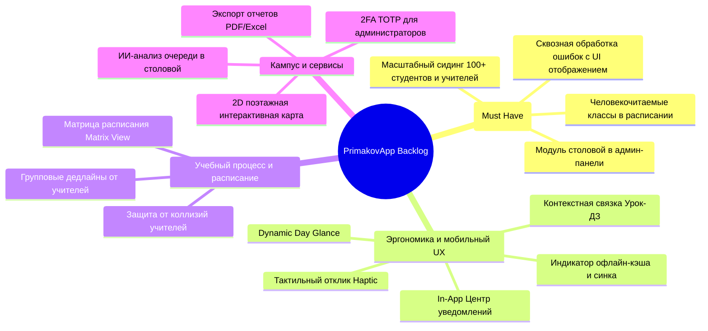
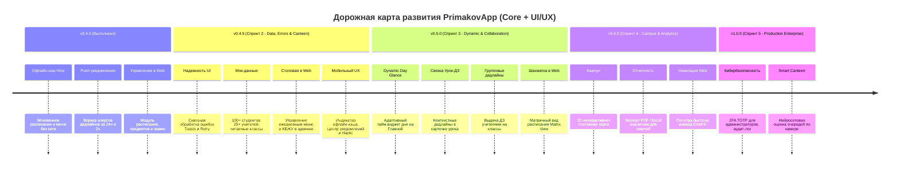

# Матрица функциональности, UI/UX и дорожная карта развития (Feature & UX Matrix & Roadmap)

Документ содержит исчерпывающий перечень возможностей цифровой экосистемы **PrimakovApp** («Гимназия им. Е.М. Примакова»), детальный статус реализации модулей, анализ разрыва между текущим состоянием и требованиями заказчика, реестр улучшений пользовательского опыта (UI/UX), а также единую матрицу приоритизации по методологиям **MoSCoW** и **RICE**.

---

## 1. Концепция продукта и ролевая модель

**PrimakovApp** спроектирован как персональный цифровой ассистент ученика, преподавателя и администрации гимназии. Продукт не ставит целью прямое дублирование государственного журнала МЭШ (оценки за уроки остаются в МЭШ), а решает прикладные задачи школьного дня и объединяет в одном окне расписание, дедлайны, сервисы кампуса, новости и коммуникацию.

### Ролевая матрица доступа (RBAC)

| Роль | Назначение и уровень доступа | Основные пользовательские сценарии |
| :--- | :--- | :--- |
| **`STUDENT`** | Учащийся гимназии | Просмотр личного расписания по классу (10-А, 11-Б), трекинг ДЗ и дедлайнов, анонимная оценка учителей, просмотр меню столовой с КБЖУ, подача заявок в техподдержку, просмотр Stories |
| **`TEACHER`** | Преподаватель / Классный руководитель | Просмотр расписания уроков и консультаций, выставление дедлайнов для своих групп, просмотр меню, отправка заявок на ремонт оборудования |
| **`ADMIN`** | Сотрудник учебной части / IT-отдела / Комбината питания | Доступ к веб-панели управления, управление пользователями, модерация заявок служб, управление расписанием и заменами, **ведение ежедневного меню столовой** |
| **`SUPERADMIN`** | Директорат / Завучи | Полный доступ ко всем модулям, назначение ролей, аудит действий пользователей, экспорт аналитических отчетов |
| **`STAFF`** | Персонал служб (IT, Клининг, Завхоз) | Получение и смена статусов сервисных заявок («В работе», «Выполнено») |

---

## 2. Реестр реализованного функционала (Current State — 100% Ready)

В рамках этапов MVP, Admin Panel и Спринта 1 (v0.4.0) полностью разработаны, протестированы и интегрированы следующие подсистемы:

### 2.1. Клиентская часть (Flutter Mobile + Desktop Web)

| Фича | Платформа | Реализация в коде | Описание функционала | Статус |
| :--- | :---: | :--- | :--- | :---: |
| **Авторизация и сессии** | Mobile / Web | `login_screen.dart` / `LoginModal.tsx` | Вход по корпоративному email и паролю, выпуск JWT токена (TTL: 7 дней), сохранение сессии, переключение серверов (Local / VPS) и Demo-режим | ✅ Готово |
| **Персональное расписание** | Mobile | `schedule_screen.dart` | Выборка уроков по датам для конкретного ученика (`user_id`), отображение кабинета, преподавателя, времени звонков и прикрепленного ДЗ | ✅ Готово |
| **Офлайн-кэш расписания и меню (Hive)** | Mobile | `offline_cache_service.dart`, `schedule_provider.dart`, `canteen_provider.dart` | Локальное хранение расписания и меню на Hive. Мгновенная отрисовка данных без сети, фоновая синхронизация | ✅ Готово (v0.4.0) |
| **Трекер дедлайнов** | Mobile | `deadline_screen.dart` | Создание учебных задач, фильтрация (все / активные / завершенные), отметка выполнения с анимацией конфетти | ✅ Готово |
| **Push-уведомления о дедлайнах (24ч и 2ч)** | Mobile / Backend | `push_notification_service.dart` / `ProcessDeadlineNotificationsUseCase.ts` | Фоновый воркер проверяет сроки сдачи, отправляет пуши за 24 ч и 2 ч. Мобильный клиент парсит срочные алерты и сохраняет их | ✅ Готово (v0.4.0) |
| **Рейтинг преподавателей** | Mobile / Web | `teacher_ratings_screen.dart` / `RatingsView.tsx` | Анонимное оценивание учителей (1–5 звезд) с комментариями, защита от накрутки через IP-хеш, модерация отзывов администрацией | ✅ Готово |
| **Истории гимназии (Stories)** | Mobile | `story_viewer_screen.dart` | Медиа-анонсы с поддержкой изображений, переходом по внешним гиперссылкам и фиксацией факта просмотра в БД | ✅ Готово |
| **Меню столовой** | Mobile | `canteen_menu_screen.dart` | Просмотр блюд на сегодня и на выбранную дату: подсчет калорийности, КБЖУ, бейджи аллергенов и вегетарианских позиций | ✅ Готово |
| **Кампусный навигатор** | Mobile | `rooms_list_screen.dart` | Справочник аудиторий гимназии с группировкой по корпусам, этажам и GPS/координатам | ✅ Готово |
| **Сервисные заявки (Helpdesk)** | Mobile / Web | `create_request_screen.dart` / `RequestsView.tsx` | Подача заявок на IT-поддержку, хозяйственный ремонт или клининг аудиторий с указанием приоритета (Low/Medium/High/Urgent) | ✅ Готово |
| **Админ-дашборд (Overview)** | Web | `DashboardView.tsx` | Бенто-сетка ключевых метрик гимназии (ученики, учителя, индекс CSI 4.88, посещаемость), график недельной активности, алерты | ✅ Готово |
| **Управление пользователями** | Web | `UsersView.tsx` | Поиск, фильтры по ролям, пагинация, модальное окно добавления, пакетный импорт CSV, переключение статуса активности и мягкое удаление | ✅ Готово |
| **Управление расписанием и заменами** | Web | `ScheduleView.tsx` | Справочник учебных дисциплин, привязка преподавателей к предметам, добавление уроков в расписание классов и оперативная замена учителей | ✅ Готово (v0.4.0) |

---

### 2.2. Серверная архитектура и база данных (Clean Architecture)

- **Ядро и сценарии (Use Cases)**:
  - 12 изолированных контекстов в `backend/src/application/`.
  - Модуль расписания и замен: `GetAllSchedulesAdminUseCase`, `SubstituteTeacherUseCase`, `AddLessonToScheduleUseCase`.
  - Модуль предметов и кафедр: `CreateSubjectUseCase`, `GetSubjectsUseCase`, `DeleteSubjectUseCase`, `AssignTeacherSubjectUseCase`, `RemoveTeacherSubjectUseCase`, `GetTeacherSubjectsUseCase`.
  - Модуль пуш-нотификаций: `ProcessDeadlineNotificationsUseCase`, `DeadlineNotificationWorker`.
  - Модуль администрирования: `AdminGetDashboardStatsUseCase`, `AdminGetUsersUseCase`, `AdminCreateUserUseCase`, `AdminUpdateUserStatusUseCase`, `AdminDeleteUserUseCase`, `AdminBatchImportUsersUseCase`.
- **База данных PostgreSQL**:
  - 22 версионированные SQL-миграции (`001` – `022`).
  - Миграция `020`: справочник дисциплин (`subjects`, `teacher_subjects`).
  - Миграция `022`: дедупликация push-уведомлений о дедлайнах (`deadline_notifications`).
  - Мягкое удаление (`deleted_at`), аудит изменений (`audit_logs`), системные параметры (`system_settings`).
- **Контроль качества**:
  - **262 автоматизированных теста Jest на бэкенде** (100% прохождение, 24 тестовых сьюта).
  - **20 автоматизированных тестов во Flutter** (Unit, Widgets & Integration-тесты кэша и пушей).
  - Строгий TDD (Test-Driven Development) подход.

---

## 3. Реестр будущих фич и улучшений UI/UX (Backlog)

### 3.1. Задачи наивысшего приоритета (Top Priority Initiatives)

#### 🔴 TOP-1: Сквозная обработка ошибок с дружелюбным UI-отображением (ERR-01 / Global Error Feedback)
* **Проблема**: При сбоях сети, серверных ошибках 500, истечении токена 401 или невалидном вводе пользователь сейчас рискует столкнуться либо с тихим падением (тихий лог в консоль), либо с бесконечным лоадером. Это разрушает доверие к приложению.
* **Решение**:
  - **Глобальные всплывающие Toast / SnackBar уведомления**: цветовая схема статусов (Success — зеленый, Warning — янтарный, Error — рубиновый `#BA1A1A`), понятные формулировки на русском языке («Не удалось подключиться к серверу», «Преподаватель уже занят в этот временной слот»).
  - **Error Boundaries и экраны восстановления**: аккуратные карточки ошибок с понятным объяснением и кнопкой *«Повторить попытку»* вместо белого экрана.
  - **Инлайн-валидация форм**: мгновенная подсветка обязательных полей при добавлении уроков, замен или пользователей с подсказками до отправки.
  - **Информативные пустые состояния (Empty States)**: аккуратные иллюстрации («На выбранный день уроков нет», «Все дедлайны выполнены») вместо пустых белых блоков.

#### 🔴 TOP-2: Генерация реалистичных мок-данных большого объема (SEED-01 / 100+ Студентов и Учителей)
* **Проблема**: В базе данных и моках мало тестовых пользователей, а расписание завязано на сырые UUID (`5a5c19fb-aecf-4df7-a4a2-d83311cc6299`), как зафиксировано на скриншоте веб-админки. Это мешает тестированию фильтров, пагинации и восприятию расписания.
* **Решение**:
  - Генерация **100+ учащихся**, распределенных по 10+ классам и параллелям:
    - Начальная школа: `1-А`, `2-Б`, `4-А`
    - Средняя школа: `5-А`, `6-Б`, `7-А`, `8-В`, `9-А`, `9-Б`
    - Старшая школа: `10-А` (соц-эк), `10-Б` (физ-мат), `11-А` (гум), `11-Б` (IT/IB).
    - Реалистичные русскоязычные ФИО, корпоративные адреса `@primakov.school`, классы, а также история оценок и дедлайнов.
  - Генерация **25+ преподавателей**, распределенных по кафедрам (Кафедра математики, Кафедра словесности, Кафедра естественных наук, Кафедра иностранных языков, Кафедра IT и робототехники, Кафедра физкультуры).
  - **Человекочитаемые названия классов в расписании**: замена технических UUID в фильтрах и заголовках расписания на читаемые бейджи классов (`10-А`, `11-Б`) как в админке, так и во Flutter.

#### 🔴 TOP-3: Модуль управления меню столовой в веб-админке (ADM-01 / Canteen Web Management)
* **Проблема**: Мобильное приложение уже умеет отображать КБЖУ, аллергены и категории меню, но в веб-админке отсутствует интерфейс для шеф-повара и комбината питания. Меню невозможно создать или скорректировать через веб-интерфейс.
* **Решение**:
  - Новый пункт навигации в `Sidebar.tsx`: **«Столовая и меню»** (иконка `restaurant_menu`).
  - Управление меню на неделю с разделением по приемам пищи: *Завтрак*, *Обед*, *Полдник*, *Ужин*.
  - Создание и редактирование карточки блюда:
    - Название, описание, категория (Супы, Горячее, Гарниры, Салаты, Напитки, Выпечка).
    - КБЖУ: калорийность (ккал), белки, жиры, углеводы, вес порции (г), цена.
    - Бейджи аллергенов: *Глютен*, *Лактоза*, *Орехи*, *Рыба*, *Яйца*.
    - Теги: *Вегетарианское*, *Халяль*, *Постное*, *Без сахара*.
  - Функция клонирования рациона на следующую неделю (Copy week menu).
  - Эндпоинты в backend Clean Architecture: CRUD для рационов и блюд столовой.

---

### 3.2. Функциональный бэклог (Core Features)

1. **Групповые дедлайны от преподавателей (F-01)**:
   - Создание ДЗ преподавателем одновременно для всего класса или подгруппы.
   - Синхронизация с личными трекерами дедлайнов учащихся группы.
2. **2D векторная интерактивная карта кампуса (F-02)**:
   - Векторные интерактивные схемы этажей гимназии с поиском кабинетов, столовой и спорткомплекса.
   - Построение кратчайшего маршрута между аудиториями.
3. **Экспорт аналитических отчетов PDF / Excel в админке (F-03)**:
   - Формирование сводок для завучей: посещаемость занятий, активность подачи заявок, рейтинг кафедр.
4. **Сброс пароля через корпоративный Email (F-04)**:
   - Отправка безопасных одноразовых ссылок сброса пароля без привлечения IT-отдела.
5. **Двухфакторная аутентификация (2FA / TOTP) (F-05)**:
   - Защита учетных записей администраторов через Google Authenticator / Яндекс Ключ.
6. **ИИ-детектор очереди столовой по камере (F-06)**:
   - Интеграция с потоком камеры обеденного зала (OpenCV/YOLO) с выводом статуса загруженности.
7. **Telegram-бот дублирования оповещений (F-07)**:
   - Трансляция важных общешкольных анонсов и замен в родительский канал.

---

### 3.3. Реестр улучшений пользовательского интерфейса и эргономики (UI/UX Backlog)

* **UI-01: Dynamic Day Glance (Time-Aware баннер дня на Главной во Flutter)**:
  - Верхний адаптивный смарт-виджет, меняющийся по времени суток (*«До 1-го урока 15 мин • Алгебра, Каб. 314»* утром, *«Большая перемена • Меню столовой»* в обед, *«Дедлайны на завтра»* вечером).
* **UI-02: Центр уведомлений и колокольчик (In-App Notification Center во Flutter)**:
  - Иконка «Колокольчик» с бейджем непрочитанных в шапке -> шторка/экран с историей уведомлений (дедлайны, замены уроков, статусы тикетов).
* **UI-03: Мягкий индикатор офлайн-статуса и синхронизации (Soft Offline Badge во Flutter)**:
  - Аккуратный анимированный чип под AppBar: *«Данные из кэша (обновлено сегодня в 08:15)»* + кнопка быстрого обновления.
* **UI-04: Контекстная связка «Урок ↔ Дедлайн» в расписании (Contextual Homework во Flutter)**:
  - На карточке урока в сетке расписания бейдж *«Есть ДЗ к сдаче»*. Тап по уроку сразу показывает прикрепленный дедлайн.
* **UI-05: Интерактивная матрица расписания (Timetable Matrix Grid View в Admin Web)**:
  - Полноэкранная интерактивная шахматка («Классы по горизонтали, Слоты уроков 1–7 по вертикали») с цветовым кодированием кафедр.
* **UI-06: Защита от конфликтов преподавателей (Collision Detection в Admin Web)**:
  - Валидация занятости учителей при замене с подсветкой статуса *«Свободен»* или *«Ведет урок в 9Б, каб. 204»*.
* **UI-07: Тактильный отклик и микроинтеракции (Haptic Feedback & Micro-interactions во Flutter)**:
  - Подключение `HapticFeedback.lightImpact()` при отметке чекбокса дедлайна, свайп-действия в списках.
* **UI-08: Командная строка быстрого поиска (Global Command Palette `Cmd+K` в Admin Web)**:
  - Всплывающая строка `Cmd+K` / `Ctrl+K` для мгновенного перехода в любой раздел, поиска карточки ученика или преподавателя.
* **UI-09: Полноценный Deep Linking для Push-уведомлений**:
  - Прямой переход по ссылке пуша (`/deadlines/:id`, `/schedule/:date`) в детальную карточку конкретной задачи или урока.

---

## 4. Единая матрица приоритизации (MoSCoW & RICE)

Для объективной приоритизации объединенного бэклога применен фреймворк **RICE Scoring**:
$$\text{RICE Score} = \frac{\text{Reach (Охват чел/мес)} \times \text{Impact (Влияние)} \times \text{Confidence (Уверенность)}}{\text{Effort (Трудозатраты в днях)}}$$

- **Reach**: 1200 — все гимназисты, 1100 — мобильные пользователи, 900 — средняя/старшая школа, 200 — администраторы и учителя, 50 — завучи.
- **Impact**: 5 — критическое/колоссальное, 4 — высокое, 3 — умеренное, 2 — небольшое, 1 — минимальное.
- **Confidence**: 100% — полное ТЗ / готовый прототип, 90% — отработанный паттерн, 80% — стандартная разработка, 50% — R&D гипотеза.
- **Effort**: человеко-дни разработки и тестирования.

### Сводная таблица RICE (отсортирована по приоритету)

| № | ID | Инициатива / Фича | Тип | Reach | Impact | Conf | Effort | RICE | MoSCoW | Спринт реализации |
| :-: | :---: | :--- | :---: | :---: | :---: | :---: | :---: | :---: | :---: | :---: |
| **—** | *SEED-01* | *[Реализовано] Мок-данные 100+ студентов, 25+ учителей, читаемые классы* | Core/Data | 1200 | 4 | 100% | 1.0 | *4800* | 🔴 *Must Have* | *Выполнено (v0.4.5)* |
| **—** | *UI-07* | *[Реализовано] Тактильный отклик (Haptic) и микроинтеракции* | UI/UX | 1100 | 2 | 90% | 0.5 | *3960* | 🔴 *Must Have* | *Выполнено (v0.4.5)* |
| **—** | *ERR-01* | *[Реализовано] Сквозная обработка ошибок с UI-отображением (Toasts/Retry)* | UI/UX | 1200 | 5 | 95% | 1.5 | *3800* | 🔴 *Must Have* | *Выполнено (v0.4.5)* |
| **—** | *UI-03* | *[Реализовано] Мягкий индикатор офлайн-кэша и синка* | UI/UX | 1100 | 3 | 95% | 1.0 | *3135* | 🔴 *Must Have* | *Выполнено (v0.4.5)* |
| **—** | *UI-02* | *[Реализовано] Центр уведомлений (In-App Bell & History)* | UI/UX | 1200 | 4 | 90% | 2.0 | *2160* | 🔴 *Must Have* | *Выполнено (v0.4.5)* |
| **6** | **UI-01** | **Dynamic Day Glance (Time-Aware баннер дня)** | UI/UX | 1200 | 4 | 85% | 2.0 | **2040** | 🔴 **Must Have** | **Спринт 3 (v0.5.0)** |
| **—** | *ADM-01* | *[Реализовано] Модуль меню столовой в веб-админке (Canteen Web)* | Core/Admin | 1100 | 4 | 90% | 2.0 | *1980* | 🔴 *Must Have* | *Выполнено (v0.4.5)* |
| **8** | **UI-04** | **Контекстная связка «Урок ↔ Дедлайн»** | UI/UX | 1000 | 3 | 90% | 1.5 | **1800** | 🔴 **Must Have** | **Спринт 3 (v0.5.0)** |
| **—** | *F-M2* | *[Реализовано] Офлайн-кэш во Flutter (Hive)* | Core | 1100 | 4 | 95% | 3.0 | *1393* | 🔴 *Must Have* | *Выполнено (v0.4.0)* |
| **—** | *F-M1* | *[Реализовано] Push-уведомления о дедлайнах 24ч/2ч* | Core | 1200 | 5 | 90% | 4.0 | *1350* | 🔴 *Must Have* | *Выполнено (v0.4.0)* |
| **9** | **UI-09** | **Deep Linking для push-уведомлений в карточку** | UI/UX | 1200 | 3 | 85% | 2.0 | **1530** | 🟡 **Should Have** | **Спринт 3 (v0.5.0)** |
| **10**| **F-01** | **Групповые дедлайны от преподавателей** | Core | 900 | 4 | 85% | 3.0 | **1020** | 🟡 **Should Have** | **Спринт 3 (v0.5.0)** |
| **11**| **F-02** | **2D интерактивная карта этажей кампуса** | Core | 1200 | 3 | 75% | 6.0 | **450** | 🟡 **Should Have** | **Спринт 4 (v0.6.0)** |
| **12**| **F-04** | **Сброс пароля через корпоративный Email** | Core | 300 | 3 | 90% | 2.0 | **405** | 🟡 **Should Have** | **Спринт 4 (v0.6.0)** |
| **—** | *UI-06* | *[Реализовано] Защита от конфликтов учителей (Collision Detection)* | UI/UX | 150 | 4 | 90% | 1.5 | *360* | 🟡 *Should Have* | *Выполнено (v0.4.5)* |
| **14**| **F-07** | **Telegram-бот дублирования оповещений** | Core | 600 | 2 | 80% | 3.0 | **320** | ⚪ **Won't Have** | **Backlog** |
| **15**| **UI-08** | **Command Palette (`Cmd+K`) в Admin Web** | UI/UX | 150 | 3 | 80% | 1.5 | **240** | 🟡 **Should Have** | **Спринт 4 (v0.6.0)** |
| **16**| **UI-05** | **Интерактивная матрица расписания (Matrix Grid)** | UI/UX | 200 | 4 | 85% | 3.0 | **226** | 🟡 **Should Have** | **Спринт 3 (v0.5.0)** |
| **—** | *F-M3* | *[Реализовано] Управление расписанием в Web* | Core | 200 | 5 | 90% | 5.0 | *180* | 🔴 *Must Have* | *Выполнено (v0.4.0)* |
| **17**| **F-06** | **ИИ-детектор очереди столовой по камере** | Core | 1000 | 2 | 50% | 10.0 | **100** | 🟢 **Could Have** | **Спринт 5 (R&D v1.0)** |
| **18**| **F-03** | **Экспорт отчетов PDF / Excel в админке** | Core | 50 | 4 | 95% | 2.0 | **95** | 🟡 **Should Have** | **Спринт 4 (v0.6.0)** |
| **19**| **F-05** | **Двухфакторная аутентификация (2FA / TOTP)** | Core | 20 | 4 | 85% | 3.0 | **23** | 🟢 **Could Have** | **Спринт 5 (v1.0.0)** |

---

## 5. Дорожная карта релизов (Release Roadmap)

### Подробный состав спринтов:

#### Спринт 2 (Релиз v0.4.5 «Data Quality, Error Handling & Canteen Management») — ✅ Выполнен
*Фокус: ликвидация блокеров, стабильность отображения ошибок и наполнение реалистичными данными.*
1. ✅ **[ERR-01] Сквозная обработка ошибок с UI-отображением (ТОП-1 ПРИОРИТЕТ)**: всплывающие Toast-уведомления при сбоях сети/API, глобальный Error Boundary с кнопкой «Повторить попытку», инлайн-валидация форм ввода, аккуратные Empty States.
2. ✅ **[SEED-01] Мок-данные большого объема (100+ студентов, 25+ учителей)**: реалистичные профили по 10+ параллелям, привязка человекочитаемых классов (`10-А`, `11-Б`) вместо raw UUID в расписании (устранение бага со скриншота).
3. ✅ **[ADM-01] Модуль управления меню столовой в веб-админке**: вкладка управления рационом (Завтрак/Обед/Полдник/Ужин), редактирование КБЖУ, бейджи аллергенов, привязка к датам, копирование меню недели и мгновенная синхронизация с мобильным приложением.
4. ✅ **[UI-07] Haptic Feedback во Flutter**: тактильный виброотклик при чекбоксах и свайпах (`RICE: 3960`), переключении табов, приоритетов дедлайнов и выставлении оценок учителям.
5. ✅ **[UI-03] Индикатор офлайн-кэша во Flutter**: визуальный статус синхронизации и время последнего обновления (`RICE: 3135`) с кнопкой мгновенного повтора в расписании и столовой.
6. ✅ **[UI-02] Центр уведомлений (In-App Bell) во Flutter**: локальное хранилище и экран истории пушей (`RICE: 2160`) с бейджем счетчика, фильтрацией по категориям (срочные 2ч, дедлайны 24ч, расписание) и кнопкой «Прочитать все».
7. ✅ **[UI-06] Collision Detection в Admin Web**: проверка занятости учителя и аудитории при назначении урока или замены (`RICE: 360`) с предупреждающим баннером.

#### Спринт 3 (Релиз v0.5.0 «Dynamic UI & Academic Collaboration») — 8 рабочих дней
*Фокус: контекстный интерфейс дня, расширенное расписание (все классы 1–11 и ИУП), справочник предметов и совместная работа с домашними заданиями.*
1. **[SCH-01] Гибкое расписание всех параллелей (1–11) и индивидуальные учебные планы (ИУП)**: структурированный селектор ступеней (1–4, 5–9, 10–11), переключение режимов «По классам» / «По ученикам (ИУП)» / «По преподавателям», детальное редактирование всех полей урока (предмет, ФИО учителя с автоподстановкой, кабинет, этаж, временные слоты звонков, тип подгруппы/профиля, ДЗ).
2. **[SUBJ-01] Справочник предметов и матрица закрепления преподавателей**: 25+ базовых предметов гимназии с привязкой к кафедрам (Точные, Гуманитарные, Естественные, Языки, Спорт), CRUD предметов, удобное назначение учителей с чекбоксами и поиском.
3. **[UI-01] Dynamic Day Glance во Flutter**: адаптивная карточка текущего дня с таймером до ближайшего урока (`RICE: 2040`).
4. **[UI-04] Контекстная связка «Урок ↔ Дедлайн» во Flutter**: бейджи ДЗ в сетке расписания с быстрым переходом (`RICE: 1800`).
5. **[UI-09] Deep Linking для push-уведомлений**: прямой переход из баннера в карточку дедлайна или урока (`RICE: 1530`).
6. **[F-01] Групповые дедлайны от преподавателей**: назначение задач учителями на весь класс или подгруппу (`RICE: 1020`).
7. **[UI-05] Интерактивная матрица расписания (Matrix Grid View) в Web**: шахматка параллелей для завуча (`RICE: 226`).

#### Спринт 4 (Релиз v0.6.0 «Campus Navigation & Analytics») — 8 рабочих дней
*Фокус: инфраструктурные сервисы кампуса и управленческая отчетность.*
1. **[F-02] 2D интерактивная карта кампуса**: поэтажные векторные планы и маршруты (`RICE: 450`).
2. **[F-04] Восстановление пароля через Email**: автоматический сброс по ссылке (`RICE: 405`).
3. **[UI-08] Command Palette (`Cmd+K`) в Admin Web**: быстрая клавиатурная навигация (`RICE: 240`).
4. **[F-03] Экспорт отчетов PDF / Excel**: аналитика для завучей и администрации (`RICE: 95`).

#### Спринт 5 (Релиз v1.0.0 «Enterprise School Platform») — 12 рабочих дней
*Фокус: промышленная надежность, безопасность и инновации.*
1. **[F-05] Двухфакторная аутентификация (2FA / TOTP)**: TOTP для администраторов (`RICE: 23`).
2. **[F-06] ИИ-детектор очереди в столовой**: компьютерное зрение для мониторинга обеденного зала (`RICE: 100`).
3. Полный аудит безопасности, нагрузочное тестирование и передача в эксплуатацию.
