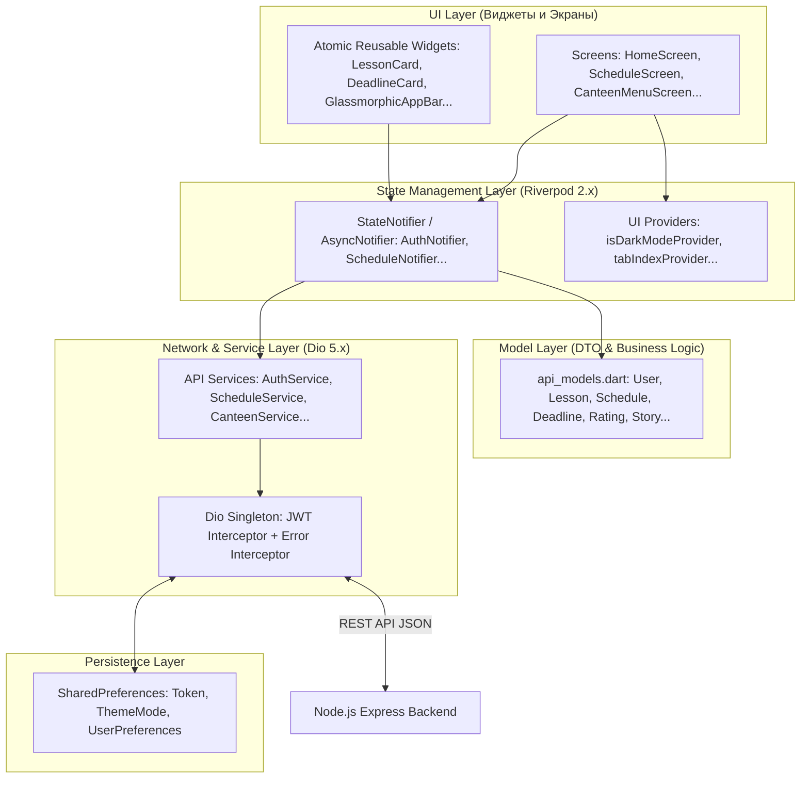

# Архитектура и декомпозиция Frontend (Flutter / Riverpod)

Данный документ содержит исчерпывающее техническое описание клиентской части **PrimakovApp**, написанной на Flutter (Dart). Включает детальный разбор всех экранов, провайдеров состояния (Riverpod), виджетов, API-сервисов и дизайн-системы.

---

## 1. Архитектурный паттерн клиента

Мобильное приложение построено по реактивному паттерну **MVVM / Layered Architecture with Riverpod**:

### 1.1. Навигационная структура (Navigator 2.0 / IndexedStack)
Точка входа: [flutter/lib/main.dart](file:///c:/Users/sasha/ВШЭ/3%20курс/Digital_PM/Primakov_App/flutter/lib/main.dart)
- `PrimakovApp` проверяет провайдер `isAuthenticatedProvider`:
  - `false` $\rightarrow$ `AuthNavigator`: стек авторизации (`LoginScreen`, `RegisterScreen`).
  - `true` $\rightarrow$ `MainNavigator`: постоянный нижний бар (`BottomNavigationBar`) с 4 вкладками на базе `IndexedStack` (сохраняет состояние и скролл экранов):
    1. **Tab 0 (`Home`)**: [HomeScreen](file:///c:/Users/sasha/ВШЭ/3%20курс/Digital_PM/Primakov_App/flutter/lib/screens/main/home_screen.dart) — Bento Grid дашборд со сторис, балансом столовой, цитатой дня и новостями.
    2. **Tab 1 (`Schedule`)**: [ScheduleScreen](file:///c:/Users/sasha/ВШЭ/3%20курс/Digital_PM/Primakov_App/flutter/lib/screens/main/schedule_screen.dart) — Календарная лента индивидуального расписания с деталями уроков и ДЗ.
    3. **Tab 2 (`Services`)**: [ServicesScreen](file:///c:/Users/sasha/ВШЭ/3%20курс/Digital_PM/Primakov_App/flutter/lib/screens/main/services_screen.dart) — Каталог гимназических сервисов (Меню столовой, Рейтинг учителей, Аудитории кампуса, Заявки, Объявления, Дедлайны).
    4. **Tab 3 (`Profile`)**: [ProfileScreen](file:///c:/Users/sasha/ВШЭ/3%20курс/Digital_PM/Primakov_App/flutter/lib/screens/main/profile_screen.dart) — Профиль пользователя, роль, смена пароля, переключение темной темы и выход.

---

## 2. Поэкранная декомпозиция (Screens Directory)

Расположение: [flutter/lib/screens/](file:///c:/Users/sasha/ВШЭ/3%20курс/Digital_PM/Primakov_App/flutter/lib/screens)

### 2.1. Группа авторизации (`screens/auth/`)
| Экран | Файл | Ответственность | Используемые Providers | Вызываемые Actions / Маршруты |
| :--- | :--- | :--- | :--- | :--- |
| **LoginScreen** | [login_screen.dart](file:///c:/Users/sasha/ВШЭ/3%20курс/Digital_PM/Primakov_App/flutter/lib/screens/auth/login_screen.dart) | Ввод email и пароля, валидация, анимация логотипа, вход в систему. | `authProvider`, `isDarkModeProvider` | `ref.read(authProvider.notifier).login(email, pass)`, переход на `RegisterScreen`. |
| **RegisterScreen**| [register_screen.dart](file:///c:/Users/sasha/ВШЭ/3%20курс/Digital_PM/Primakov_App/flutter/lib/screens/auth/register_screen.dart) | Регистрация нового аккаунта (Имя, Фамилия, Email, Пароль, подтверждение пароля). | `authProvider` | `ref.read(authProvider.notifier).register(...)`, возврат на `LoginScreen`. |

### 2.2. Основные экраны и вкладки (`screens/main/`)
| Экран | Файл | Ответственность | Состояние и Виджеты | Граничные состояния (Edge cases) |
| :--- | :--- | :--- | :--- | :--- |
| **HomeScreen** | [home_screen.dart](file:///c:/Users/sasha/ВШЭ/3%20курс/Digital_PM/Primakov_App/flutter/lib/screens/main/home_screen.dart) | Главный интерактивный дашборд. Горизонтальная лента Stories, карточка баланса столовой, карточка сегодняшнего расписания, блок дедлайнов, лента новостей гимназии. | `storyProvider`, `deadlineProvider`, `scheduleProvider`, `authProvider`. Виджеты: `StoryCard`, `TodayScheduleWidget`. | Скелетонная загрузка при обновлении через `RefreshIndicator`. Если сторис нет — скрытие секции. |
| **ScheduleScreen** | [schedule_screen.dart](file:///c:/Users/sasha/ВШЭ/3%20курс/Digital_PM/Primakov_App/flutter/lib/screens/main/schedule_screen.dart) | Индивидуальное расписание уроков. Горизонтальный скролл календаря дат, таймлайн уроков. | `scheduleProvider`, `authProvider`. Виджеты: `LessonCard`, `GlassmorphicAppBar`. | Выходной день: плейсхолдер «Уроков нет, отличного отдыха!». Ошибка загрузки: кнопка повтора «Попробовать снова». |
| **LessonDetailScreen** | [lesson_detail_screen.dart](file:///c:/Users/sasha/ВШЭ/3%20курс/Digital_PM/Primakov_App/flutter/lib/screens/main/lesson_detail_screen.dart) | Детальная карточка урока: аудитория, этаж, корпус, преподаватель, время начала/конца, полное описание домашнего задания. | Принимает аргумент `Lesson`. Переход по кнопке «Оценить учителя» на `TeacherRatingsScreen`. | Если ДЗ отсутствует — блок «Домашнее задание не задано». |
| **DeadlineScreen** | [deadline_screen.dart](file:///c:/Users/sasha/ВШЭ/3%20курс/Digital_PM/Primakov_App/flutter/lib/screens/main/deadline_screen.dart) | Менеджер учебных дедлайнов с фильтрами («Все», «В процессе», «Выполненные», «Просроченные»). | `deadlineProvider`. Виджеты: `DeadlineCard`, `ConfettiWidget` при завершении задачи. | Пустой список: плашка с иллюстрацией и кнопкой «Добавить дедлайн». |
| **AddDeadlineScreen** | [add_deadline_screen.dart](file:///c:/Users/sasha/ВШЭ/3%20курс/Digital_PM/Primakov_App/flutter/lib/screens/main/add_deadline_screen.dart) | Форма создания дедлайна: название предмета, заголовок задачи, описание, выбор даты и времени через `DatePicker`. | `deadlineProvider`. Валидация: название не пустое, дата не в прошлом. | Блокировка кнопки сохранения во время отправки запроса. |
| **StoryViewerScreen** | [story_viewer_screen.dart](file:///c:/Users/sasha/ВШЭ/3%20курс/Digital_PM/Primakov_App/flutter/lib/screens/main/story_viewer_screen.dart) | Полноэкранный плеер сторис с таймером автоперелистывания (progress bar), поддержкой изображений, видео и внешней кнопки-ссылки (`url_launcher`). | `storyProvider`. Автоматическая отправка `markStoryAsViewed(storyId)`. | Ошибка загрузки картинки: показ фонового градиента гимназии с текстом описания. |
| **ServicesScreen** | [services_screen.dart](file:///c:/Users/sasha/ВШЭ/3%20курс/Digital_PM/Primakov_App/flutter/lib/screens/main/services_screen.dart) | Сетка плиток быстрого перехода во вспомогательные модули + поисковая строка по сервисам. | Навигация на `CanteenMenuScreen`, `TeacherRatingsScreen`, `RoomsListScreen`, `CreateRequestScreen`, `AnnouncementsScreen`. | Фильтрация плиток на лету по поисковому запросу. |
| **ProfileScreen** | [profile_screen.dart](file:///c:/Users/sasha/ВШЭ/3%20курс/Digital_PM/Primakov_App/flutter/lib/screens/main/profile_screen.dart) | Данные пользователя, бейдж роли (Ученик, Учитель, Администратор), кнопки перехода к редактированию профиля, настройкам и выходу. | `authProvider`, `userProvider`, `isDarkModeProvider`. | Диалог подтверждения перед выходом из аккаунта. |
| **EditProfileScreen** | [edit_profile_screen.dart](file:///c:/Users/sasha/ВШЭ/3%20курс/Digital_PM/Primakov_App/flutter/lib/screens/main/edit_profile_screen.dart) | Редактирование имени и фамилии пользователя. | `userProvider`, `authProvider`. | Валидация непустых полей; обновление состояния в `authProvider`. |
| **ChangePasswordScreen**| [change_password_screen.dart](file:///c:/Users/sasha/ВШЭ/3%20курс/Digital_PM/Primakov_App/flutter/lib/screens/main/change_password_screen.dart)| Безопасная смена пароля (старый пароль, новый пароль, подтверждение). | `userProvider`. | Проверка совпадения паролей и соответствия политике сложности. |
| **SettingsScreen** | [settings_screen.dart](file:///c:/Users/sasha/ВШЭ/3%20курс/Digital_PM/Primakov_App/flutter/lib/screens/main/settings_screen.dart) | Настройки уведомлений (пуши, дедлайны, расписание), переключение темы, информация о версии приложения. | `uiProvider`, `isDarkModeProvider`. | Мгновенное сохранение в `SharedPreferences`. |

### 2.3. Вспомогательные функциональные экраны (`screens/`)
| Экран | Файл | Ответственность | Состояние и Сервисы |
| :--- | :--- | :--- | :--- |
| **CanteenMenuScreen** | [canteen_menu_screen.dart](file:///c:/Users/sasha/ВШЭ/3%20курс/Digital_PM/Primakov_App/flutter/lib/screens/canteen_menu_screen.dart) | Меню столовой с табами по приемам пищи (Завтрак, Обед, Полдник), подсчет калорий, КБЖУ, бейджи аллергенов и цен. | `canteenProvider`. Выбор даты через календарь. Фильтрация блюд по категориям (Супы, Горячее, Салаты). |
| **TeacherRatingsScreen**| [teacher_ratings_screen.dart](file:///c:/Users/sasha/ВШЭ/3%20курс/Digital_PM/Primakov_App/flutter/lib/screens/teacher_ratings_screen.dart)| Список учителей, текущий рейтинг звезд 1-5, модальный диалог выставления анонимного отзыва. | `ratingProvider`, `userProvider` (список учителей). Защита от повторного голоса. |
| **RoomsListScreen** | [rooms_list_screen.dart](file:///c:/Users/sasha/ВШЭ/3%20курс/Digital_PM/Primakov_App/flutter/lib/screens/rooms_list_screen.dart) | Справочник аудиторий кампуса гимназии, поиск по номеру, фильтры по корпусам (`A`, `B`, `Main`) и этажам (1-4). | `roomProvider`. Карточки аудиторий с указанием вместимости и описания. |
| **CreateRequestScreen**| [create_request_screen.dart](file:///c:/Users/sasha/ВШЭ/3%20курс/Digital_PM/Primakov_App/flutter/lib/screens/create_request_screen.dart)| Оформление внутренней заявки на IT-помощь, ремонт мебели или клининг помещения. Выбор типа, приоритета, аудитории. | `requestProvider`, `roomProvider` (для дропдауна выбора кабинета). |
| **AnnouncementsScreen**| [announcements_screen.dart](file:///c:/Users/sasha/ВШЭ/3%20курс/Digital_PM/Primakov_App/flutter/lib/screens/announcements_screen.dart)| Лента официальных объявлений с тегами категорий (`Академические`, `Мероприятия`, `Срочные`). | `announcementProvider`. |

---

## 3. Декомпозиция провайдеров состояния (State Management / Riverpod)

Расположение: [flutter/lib/providers/](file:///c:/Users/sasha/ВШЭ/3%20курс/Digital_PM/Primakov_App/flutter/lib/providers)

| Провайдер | Файл | Тип состояния | Ключевые методы | Взаимодействие с API |
| :--- | :--- | :--- | :--- | :--- |
| **`authProvider`** | [auth_provider.dart](file:///c:/Users/sasha/ВШЭ/3%20курс/Digital_PM/Primakov_App/flutter/lib/providers/auth_provider.dart) | `AsyncValue<User?>` | `login(email, password)`, `register(...)`, `logout()`, `checkAuthStatus()` | Вызывает `AuthService`, сохраняет токен в `SharedPreferences` и `ApiConfig.setToken()`. |
| **`scheduleProvider`**| [schedule_provider.dart](file:///c:/Users/sasha/ВШЭ/3%20курс/Digital_PM/Primakov_App/flutter/lib/providers/schedule_provider.dart)| `AsyncValue<Schedule?>` | `loadSchedule(userId, date)`, `selectDate(DateTime)` | Запрашивает `GET /api/schedule/user/:userId/:date` через `ScheduleService`. |
| **`deadlineProvider`**| [deadline_provider.dart](file:///c:/Users/sasha/ВШЭ/3%20курс/Digital_PM/Primakov_App/flutter/lib/providers/deadline_provider.dart)| `AsyncValue<List<Deadline>>` | `loadDeadlines()`, `createDeadline(...)`, `completeDeadline(id)` | Вызывает `DeadlineService`. При отметке выполнения делает оптимистичное обновление списка в UI. |
| **`ratingProvider`** | [rating_provider.dart](file:///c:/Users/sasha/ВШЭ/3%20курс/Digital_PM/Primakov_App/flutter/lib/providers/rating_provider.dart) | `AsyncValue<List<Rating>>` | `loadRatings()`, `rateTeacher(teacherId, rate, comment)` | Отправляет отзыв через `RatingService`, обновляет локальное состояние. |
| **`canteenProvider`** | [canteen_provider.dart](file:///c:/Users/sasha/ВШЭ/3%20курс/Digital_PM/Primakov_App/flutter/lib/providers/canteen_provider.dart) | `AsyncValue<CanteenMenu?>` | `loadMenu(date, mealType)`, `selectMealType(MealType)` | Вызывает `CanteenService` (`GET /api/canteen/menu/:date/:mealType`). |
| **`roomProvider`** | [room_provider.dart](file:///c:/Users/sasha/ВШЭ/3%20курс/Digital_PM/Primakov_App/flutter/lib/providers/room_provider.dart) | `AsyncValue<List<Room>>` | `loadRooms()`, `filterByBuilding(building)`, `filterByFloor(floor)` | Вызывает `RoomService` (`GET /api/rooms`). |
| **`requestProvider`** | [request_provider.dart](file:///c:/Users/sasha/ВШЭ/3%20курс/Digital_PM/Primakov_App/flutter/lib/providers/request_provider.dart) | `AsyncValue<List<SupportRequest>>` | `loadUserRequests()`, `createRequest(...)`, `updateStatus(id, status)` | Вызывает `RequestService` (`POST /api/requests`, `GET /api/requests`). |
| **`storyProvider`** | [story_provider.dart](file:///c:/Users/sasha/ВШЭ/3%20курс/Digital_PM/Primakov_App/flutter/lib/providers/story_provider.dart) | `AsyncValue<List<Story>>` | `loadStories()`, `markAsViewed(storyId)` | Вызывает `StoryService`. Локально добавляет `userId` в список `viewedBy`. |
| **`announcementProvider`**| [announcement_provider.dart](file:///c:/Users/sasha/ВШЭ/3%20курс/Digital_PM/Primakov_App/flutter/lib/providers/announcement_provider.dart)| `AsyncValue<List<Announcement>>` | `loadAnnouncements()`, `filterByCategory(cat)` | Вызывает `AnnouncementService` (`GET /api/announcements`). |
| **`userProvider`** | [user_provider.dart](file:///c:/Users/sasha/ВШЭ/3%20курс/Digital_PM/Primakov_App/flutter/lib/providers/user_provider.dart) | `AsyncValue<List<User>>` | `loadTeachers()`, `updateProfile(name, surname)`, `changePassword(...)` | Вызывает `UserService` (`GET /api/users/teachers`, `PUT /api/users/me`). |
| **`uiProvider`** | [ui_provider.dart](file:///c:/Users/sasha/ВШЭ/3%20курс/Digital_PM/Primakov_App/flutter/lib/providers/ui_provider.dart) | `ThemeMode`, `int tabIndex` | `toggleDarkMode()`, `setTab(int index)`, `saveNotificationSettings(...)` | Управляет темной/светлой темой и индексами навигации. |

---

## 4. Каталог компонентов и переиспользуемых виджетов (Widgets)

Расположение: [flutter/lib/widgets/](file:///c:/Users/sasha/ВШЭ/3%20курс/Digital_PM/Primakov_App/flutter/lib/widgets)

| Виджет | Файл | Описание и визуальное поведение |
| :--- | :--- | :--- |
| **GlassmorphicAppBar** | [glassmorphic_app_bar.dart](file:///c:/Users/sasha/ВШЭ/3%20курс/Digital_PM/Primakov_App/flutter/lib/widgets/glassmorphic_app_bar.dart) | Верхняя панель в стиле матового стекла (Glassmorphism): размытие фона `BackdropFilter` (blur 10px), полупрозрачный фон, отображение аватарки или заголовка. |
| **LessonCard** | [lesson_card.dart](file:///c:/Users/sasha/ВШЭ/3%20курс/Digital_PM/Primakov_App/flutter/lib/widgets/lesson_card.dart) | Карточка школьного урока: время, предмет, чип номера аудитории и этажа, имя преподавателя, индикатор наличия домашнего задания с цветовой маркировкой. |
| **DeadlineCard** | [deadline_card.dart](file:///c:/Users/sasha/ВШЭ/3%20курс/Digital_PM/Primakov_App/flutter/lib/widgets/deadline_card.dart) | Карточка задания: название предмета, формулировка, дата сдачи, статус (PENDING / COMPLETED / OVERDUE), чекбокс для быстрого закрытия. |
| **StoryCard** | [story_card.dart](file:///c:/Users/sasha/ВШЭ/3%20курс/Digital_PM/Primakov_App/flutter/lib/widgets/story_card.dart) | Круглая/овальная ячейка истории в горизонтальной ленте: градиентная обводка (красный акцент — непросмотренная, серый — просмотренная), миниатюра, имя новости. |
| **TodayScheduleWidget**| [today_schedule_widget.dart](file:///c:/Users/sasha/ВШЭ/3%20курс/Digital_PM/Primakov_App/flutter/lib/widgets/today_schedule_widget.dart)| Компактный виджет для главной страницы: показывает следующий ближайший урок, текущий статус («Идет урок» / «Перемена») и кнопку перехода ко всему дню. |
| **UpcomingDeadlinesWidget**| [upcoming_deadlines_widget.dart](file:///c:/Users/sasha/ВШЭ/3%20курс/Digital_PM/Primakov_App/flutter/lib/widgets/upcoming_deadlines_widget.dart)| Виджет дашборда: отображает топ-3 ближайших горящих дедлайна с расчетом оставшихся часов/дней. |
| **CustomButton** | [custom_button.dart](file:///c:/Users/sasha/ВШЭ/3%20курс/Digital_PM/Primakov_App/flutter/lib/widgets/custom_button.dart) | Фирменная кнопка гимназии: скругление 14px, анимация нажатия, состояния `loading` (CircularProgressIndicator) и `disabled`. |
| **CustomTextField** | [custom_text_field.dart](file:///c:/Users/sasha/ВШЭ/3%20курс/Digital_PM/Primakov_App/flutter/lib/widgets/custom_text_field.dart) | Поле ввода текста с иконками префикса/суффикса, переключателем видимости пароля, поддержкой темной темы и валидационными сообщениями. |
| **CustomDropdown** | [custom_dropdown.dart](file:///c:/Users/sasha/ВШЭ/3%20курс/Digital_PM/Primakov_App/flutter/lib/widgets/custom_dropdown.dart) | Стилизованное выпадающее меню выбора (категории, аудитории, приоритеты заявок) со скругленными границами. |
| **PriorityToggle** | [priority_toggle.dart](file:///c:/Users/sasha/ВШЭ/3%20курс/Digital_PM/Primakov_App/flutter/lib/widgets/priority_toggle.dart) | Сегментированный переключатель приоритета заявок (`LOW`, `MEDIUM`, `HIGH`, `URGENT`) с соответствующей цветовой индикацией. |

---

## 5. Клиентский сетевой слой (API Services / Dio)

Расположение: [flutter/lib/services/api/](file:///c:/Users/sasha/ВШЭ/3%20курс/Digital_PM/Primakov_App/flutter/lib/services/api)

Все сервисы используют единый сконфигурированный экземпляр `Dio` из [api_config.dart](file:///c:/Users/sasha/ВШЭ/3%20курс/Digital_PM/Primakov_App/flutter/lib/config/api_config.dart).

1. **`auth_service.dart`**:
   - `login(email, password)` $\rightarrow$ `POST /api/auth/login`
   - `register(email, password, firstName, lastName)` $\rightarrow$ `POST /api/auth/register`
2. **`schedule_service.dart`**:
   - `getScheduleByUserId(userId, date)` $\rightarrow$ `GET /api/schedule/user/$userId/$date`
   - `getScheduleByGroupId(groupId, date)` $\rightarrow$ `GET /api/schedule/$groupId/$date`
3. **`deadline_service.dart`**:
   - `getDeadlines({userId})` $\rightarrow$ `GET /api/deadlines`
   - `createDeadline(deadline)` $\rightarrow$ `POST /api/deadlines`
   - `completeDeadline(id)` $\rightarrow$ `PATCH /api/deadlines/$id/complete`
4. **`rating_service.dart`**:
   - `getRatings()` $\rightarrow$ `GET /api/ratings`
   - `rateTeacher(teacherId, rate, comment)` $\rightarrow$ `POST /api/ratings`
5. **`canteen_service.dart`**:
   - `getTodaysMenu()` $\rightarrow$ `GET /api/canteen/menu/today`
   - `getMenuByDate(date)` $\rightarrow$ `GET /api/canteen/menu/$date`
   - `getMenuByDateAndMealType(date, mealType)` $\rightarrow$ `GET /api/canteen/menu/$date/$mealType`
6. **`room_service.dart`**:
   - `getAllRooms()` $\rightarrow$ `GET /api/rooms`
   - `getRoomByNumber(number)` $\rightarrow$ `GET /api/rooms/$number`
   - `getRoomsByBuilding(building)` $\rightarrow$ `GET /api/rooms/building/$building`
   - `getRoomsByFloor(building, floor)` $\rightarrow$ `GET /api/rooms/building/$building/floor/$floor`
7. **`request_service.dart`**:
   - `createRequest(request)` $\rightarrow$ `POST /api/requests`
   - `getUserRequests()` $\rightarrow$ `GET /api/requests`
   - `updateStatus(id, status)` $\rightarrow$ `PATCH /api/requests/$id/status`
8. **`story_service.dart`**:
   - `getStories()` $\rightarrow$ `GET /api/stories`
   - `markStoryAsViewed(storyId)` $\rightarrow$ `POST /api/stories/$storyId/view`
9. **`announcement_service.dart`**:
   - `getAnnouncements()` $\rightarrow$ `GET /api/announcements`
   - `getByCategory(category)` $\rightarrow$ `GET /api/announcements/category/$category`
10. **`user_service.dart`**:
    - `getTeachers()` $\rightarrow$ `GET /api/users/teachers`
    - `getCurrentUser()` $\rightarrow$ `GET /api/users/me`
    - `updateProfile(firstName, lastName)` $\rightarrow$ `PUT /api/users/me`
    - `changePassword(oldPass, newPass)` $\rightarrow$ `PUT /api/users/me/password`

---

## 6. Дизайн-система и темы (Theme & Tokens)

Расположение: [flutter/lib/config/](file:///c:/Users/sasha/ВШЭ/3%20курс/Digital_PM/Primakov_App/flutter/lib/config)

- **[app_colors.dart](file:///c:/Users/sasha/ВШЭ/3%20курс/Digital_PM/Primakov_App/flutter/lib/config/app_colors.dart)**:
  - Фирменные цвета: `primaryRed` (`#E31E24` — геральдический красный гимназии), `primaryRedDark` (`#B31419`).
  - Светлая тема: фон `#F8F9FA`, поверхность `#FFFFFF`, текст `#1A1C1D`, субтекст `#6C757D`.
  - Темная тема: фон `#121314`, поверхность `#1A1C1D`, контейнеры `#242729`, текст `#F8F9FA`.
  - Статусы: `successGreen` (`#28A745`), `warningYellow` (`#FFC107`), `errorRed` (`#DC3545`), `infoBlue` (`#17A2B8`).
- **[app_typography.dart](file:///c:/Users/sasha/ВШЭ/3%20курс/Digital_PM/Primakov_App/flutter/lib/config/app_typography.dart)**:
  - Основной шрифт: **Manrope** (заголовки h1-h4, чипы, кнопки, цифры).
  - Вспомогательный шрифт: **Inter** (описания, длинные тексты, комментарии, формы ввода).
- **[app_spacing.dart](file:///c:/Users/sasha/ВШЭ/3%20курс/Digital_PM/Primakov_App/flutter/lib/config/app_spacing.dart)**:
  - Сетка отступов: `xs: 4`, `sm: 8`, `md: 16`, `lg: 24`, `xl: 32`, `xxl: 48`.
  - Радиусы скругления: `radiusSm: 8`, `radiusMd: 14`, `radiusLg: 20`, `radiusPill: 999`.
- **[app_theme.dart](file:///c:/Users/sasha/ВШЭ/3%20курс/Digital_PM/Primakov_App/flutter/lib/config/app_theme.dart)**:
  - Сборка `ThemeData` для `lightTheme` и `darkTheme` с полной интеграцией Material 3, настройкой AppBar, BottomNavigationBar, CardTheme, DialogTheme и InputDecorationTheme.
