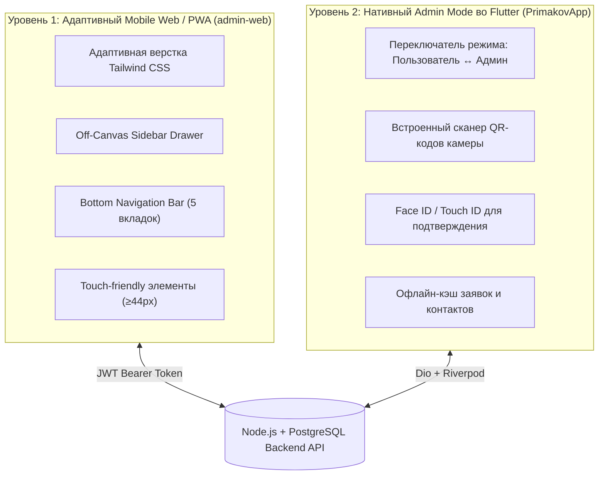

# Архитектура и концепция мобильной версии панели администратора (Primakov Mobile Admin)

> **Статус документа:** Концептуальный проект и архитектурный дизайн  
> **Проект:** Primakov School Digital Ecosystem  
> **Целевые платформы:** Адаптивный Web/PWA (`admin-web`) и Нативный модуль во Flutter (`PrimakovApp`)

---

## 1. Продуктовое видение и проблема (Why Mobile Admin?)

В классических образовательных учреждениях администратор, завуч или куратор редко проводит весь день за стационарным компьютером. Реальная жизнь кампуса Гимназии им. Примакова динамична:
- **Дежурные завучи** обходят корпуса, спортивный комплекс и столовую.
- **Диспетчеры расписания** получают звонки о внезапных болезнях учителей в 07:45 утра, за 45 минут до первого урока, находясь в дороге.
- **Воспитатели и кураторы пансиона** проводят вечернюю перекличку непосредственно в комнатах учащихся в 21:30.
- **Инженеры и IT-служба** перемещаются по этажам и должны мгновенно реагировать на аварии и заявки.

**Проблема:** Использование десктопной админки на ходу с экрана смартфона неудобно: таблицы требуют горизонтального скролла, кнопки слишком малы для касаний пальцем, а запуск ноутбука в коридоре отнимает критически важное время.

**Цель:** Создать легковесный, высокоскоростной мобильный инструмент управления, оптимизированный под работу «на ходу» одной рукой.

---

## 2. Ключевые персоны и сценарии (Jobs to Be Done)

```mermaid
journey
    title Типичные мобильные сценарии администраторов гимназии
    section 07:45 Утро (До занятий)
      Звонок заболевшего учителя: 3: Завуч
      Экспресс-замена педагога в 2 клика: 5: Завуч
      Авто-пуш классу об изменении кабинета: 5: Система
    section 12:30 Обед (Столовая)
      Проверка количества предзаказов рационов: 4: Завхоз / Дежурный
      Фиксация сбоя кассового турникета в тикете: 5: Инженер
    section 15:00 День (Кампус)
      Обход аудиторий, создание фото-заявки на клининг: 5: Комендант
      Просмотр DAU и посещаемости дня: 4: Директор
    section 21:30 Вечер (Пансион)
      Вечерняя перекличка в комнатах по QR: 5: Куратор пансиона
      Согласование увольнительной на выходные: 5: Воспитатель
```

### Матрица пользовательских ролей:
| Роль | Основной контекст | Ключевые мобильные задачи | Необходимые инструменты |
|---|---|---|---|
| **Дежурный администратор / Завуч** | В коридорах, на линейках, в пути | Срочные замены уроков, экстренные оповещения, контроль дисциплины. | Экспресс-замена, Broadcast Push, монитор посещаемости. |
| **Служба эксплуатации / IT-инженер** | На этажах, в серверных, в лабораториях | Прием срочных заявок, взятие в работу, фотофиксация решения проблемы. | Быстрый Service Desk, свайп-действия, камера. |
| **Куратор пансиона (Boarding Housemaster)** | В жилом корпусе пансиона | Фиксация присутствия студентов, сканирование пропусков, увольнительные. | Мобильный QR-сканер, список комнат, статус чекина. |
| **Руководитель / Head of School** | На встречах, в разъездах | Executive-мониторинг здоровья продукта, ключевые инциденты дня. | Верхние KPI (DAU, посещаемость, SLA), System Pulse. |

---

## 3. Двухуровневая стратегия реализации

Для обеспечения максимальной доступности и скорости разработана двухуровневая стратегия:



### Уровень 1: Адаптивный Web / PWA (`admin-web`) — *Уже внедрено базово*
- Доступен из любого мобильного браузера (Safari iOS, Chrome Android) по ссылке панели.
- На экранах $<1024$px боковое меню трансформируется в выезжающий шторкой `Sidebar Drawer` с затемнением фона (`backdrop-blur`).
- В нижней части экрана закреплен `Mobile Bottom Navigation Bar` для моментального переключения между экранами:
  1. **Дашборд** (общий пульс продукта).
  2. **Заявки** (тикеты техподдержки).
  3. **Расписание** (уроки и замены).
  4. **Ученики** (поиск по контингенту).
  5. **Еще** (открытие полного меню для доступа к столовой, пансиону и кубку домов).
- Паддинги оптимизированы: `px-4 sm:px-8`, размер кнопок не менее $44\times 44$px по гайдлайнам Apple HIG и Material Design 3.

### Уровень 2: Нативный «Режим Администратора» во Flutter (`PrimakovApp`) — *Архитектурный проект*
Если пользователь входит с ролью `ADMIN` или `SUPERADMIN` в мобильное приложение Flutter:
1. В профиле появляется бейдж и переключатель **«Панель управления кампусом»**.
2. Пользователю открывается дополнительный набор экранов, использующих нативные API смартфона (камера для QR, геолокация, биометрия, виброотклик Haptic).

---

## 4. Поэкранные спецификации мобильного интерфейса

### Экран 1: «Пульс кампуса» (Mobile Dashboard)
* **Верхний бар (Sticky App Bar):**
  - Официальный логотип `primakov_logo.png`, заголовок **Primakov Admin**, переключатель RU/EN.
  - Пульсирующий индикатор состояния: `🟢 API OK • МЭШ 08:30`.
* **Карточки метрик (Bento 2x2):**
  - **DAU**: `1 120` (84.5% активных сегодня).
  - **Посещаемость**: `96.4%` (в норме).
  - **SLA заявок**: `94.8%` (14 в работе).
  - **CSI**: `4.88` / 5.0.
* **Блок критических алертов («Требует внимания»):**
  - Красная карточка срочной аварии с кнопкой вызова исполнителя в 1 касание.
  - Статус замен расписания на текущий день.
* **Мини-график трафика:**
  - Упрощенный горизонтальный спарклайн пиковых часов (утро/обед).

### Экран 2: Экспресс-Service Desk (Mobile Tickets)
* **Селектор фильтра:** Чип-фильтры вверху экрана (`Все`, `🔥 Срочные (2)`, `IT`, `АХО`, `Клининг`).
* **Карточки заявок вместо громоздких таблиц:**
  - Каждая заявка — это карточка с темой, кабинетом, автором, бейджем приоритета и таймером нахождения в очереди (SLA counter: «Осталось 4ч»).
* **Быстрые свайп-действия (Swipe Actions):**
  - Свайп вправо $\rightarrow$ Взять заявку в работу (`IN_PROGRESS`).
  - Свайп влево $\rightarrow$ Отметить выполненной (`COMPLETED`) с возможностью прикрепить фото с камеры.

### Экран 3: Экспресс-замена преподавателей (Mobile Substitutions)
* **Сценарий в 3 шага:**
  1. Выбор даты и урока из списка (например: *«10-А класс, 3-й урок, Физика, каб. 302, учитель Соколова Е.»*).
  2. Система автоматически предлагает **только свободных в этот слот преподавателей** кафедры естественных наук с указанием их текущей нагрузки.
  3. Нажатие одной кнопки **«Утвердить замену»**:
     - Обновляется расписание в БД.
     - Ученикам 10-А отправляется push: *«Урок физики проведет Иванов И. в каб. 302»*.
     - Заменяющему педагогу отправляется персональное уведомление.

### Экран 4: Сканер и перекличка пансиона (Boarding QR Scanner)
* **Режим камеры на весь экран:**
  - Мгновенное распознавание цифрового QR-пропуска студента из мобильного приложения.
  - При сканировании высвечивается карточка: ФИО, класс, фото, Дом («Север»), статус увольнительной (согласована / не согласована родителями).
  - Кнопки фиксации: «Прибыл в кампус» / «Убыл».
* **Комнатная ведомость (Room Checklist):**
  - Группировка по этажам и комнатам с возможностью пакетной отметки присутствия одним тапом.

### Экран 5: Экстренное оповещение (Emergency Campus Broadcast)
* Предназначен для экстренных ситуаций (отмена занятий из-за погодных условий, эвакуация, срочный сбор в актовом зале).
* Крупная кнопка активации с подтверждением через биометрию (Face ID / Touch ID) для исключения случайных нажатий.
* Выбор целевой аудитории (Все / Учащиеся / Родители / Преподаватели).
* Мгновенный пуш на мобильные устройства и закрепление красного баннера на главном экране.

---

## 5. Технические требования к реализации

### Производительность и Touch-UX
- Минимальный размер кликабельной области: $44 \times 44$ px (согласно Apple HIG).
- Плавные аппаратные анимации перехода: $300$мс с easing-кривой `cubic-bezier(0.4, 0, 0.2, 1)`.
- Поддержка Safe Area (вырезы Dynamic Island, челки, нижняя панель жестов на iOS и Android).
- Обязательная поддержка системной темной темы (`Dark Mode`), не слепящей при вечернем обходе.

### Безопасность (Security Guardrails)
- Ролевая проверка (RBAC): все мобильные эндпоинты защищены JWT-токеном с проверкой роли `ADMIN` или `SUPERADMIN`.
- При простое приложения более 15 минут — автоблокировка сессии или запрос биометрии.
- Полное протоколирование действий (Audit Log): фиксация `userId`, времени и IP-адреса каждого административного изменения.

---

## 6. Дорожная карта внедрения (Roadmap)

| Этап | Задачи | Срок | Статус |
|---|---|:---:|:---:|
| **Фаза 1: Адаптивный Web** | - Внедрение off-canvas Drawer и Bottom Nav Bar в `admin-web`.<br>- Адаптация отступов и карточек дашборда под экраны $<768$px.<br>- Тестирование на мобильных устройствах iOS Safari и Chrome. | Спринт 4 | **Выполнено** ✅ |
| **Фаза 2: Мобильные тикеты и замены** | - Карточный вид Service Desk для мобильных экранов.<br>- Экспресс-модалка назначения замен преподавателей.<br>- Добавление манифеста PWA (установка иконки на рабочий стол смартфона). | Спринт 5 | В плане ⏳ |
| **Фаза 3: Нативный модуль во Flutter** | - Интеграция роли `ADMIN` во Flutter `PrimakovApp`.<br>- QR-сканер пропусков пансиона через камеру телефона.<br>- Биометрическая авторизация и экстренные push-рассылки. | Спринт 6 | В плане ⏳ |

