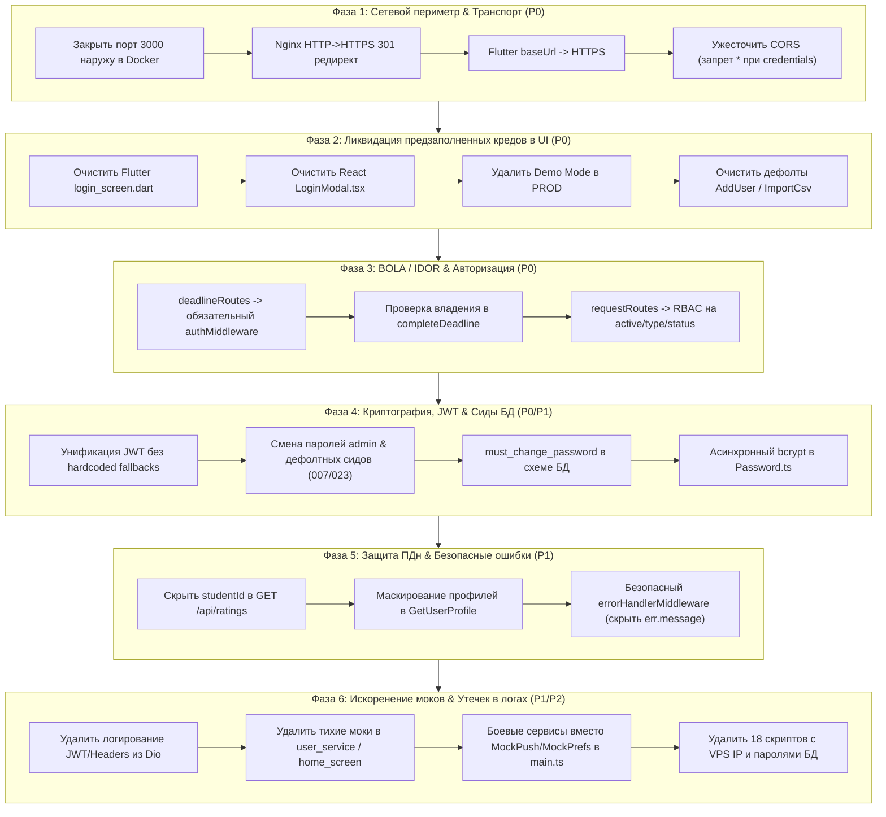

# 🛡️ Комплексный план устранения уязвимостей и подготовки к релизу PrimakovApp

Данный план объединяет результаты архитектурного аудита безопасности (`AgentShield`, SAST, DAST, анализ BOLA/IDOR) и **глубокого аудита кодовой базы на хардкод секретов, предзаполненные креды, утечки в логах и остаточные моки**.

План нацелен на устранение критических векторов компрометации, обеспечение соответствия 152-ФЗ / GDPR, защиту учетных записей гимназистов и администрации, а также на приведение всех компонентов к состоянию Production-Ready без поломки контрактов API.

---

## 🎯 Цели и архитектурные принципы реализации

1. **Строгое соблюдение Clean Architecture и правил проекта ([AGENTS.md](file:///c:/Users/sasha/ВШЭ/3%20курс/Digital_PM/Primakov_App/AGENTS.md)):**
   - Разделение по 4 слоям: `Presentation` (контроллеры, мидлвары, роуты) -> `Application` (Use Cases) -> `Domain` (Value Objects, Entities) -> `Infrastructure` (репозитории, адаптеры).
   - Контроллеры **не имеют права** напрямую вызывать SQL или обращаться к пулу БД (контролируется `AgentShield`).
   - Использование `Result Pattern` (`isSuccess`, `isFailure`, `value`, `error`) во всех Use Cases.
2. **Strict TDD (Test-Driven Development):**
   - Запрещено писать исправления логики без предварительно написанных падающих интеграционных или модульных тестов (Red -> Green -> Refactor).
3. **Безопасность по умолчанию (Secure by Default):**
   - Полное отключение незашифрованного HTTP (только TLS/HTTPS).
   - Полный запрет fallback-секретов и дефолтных паролей (`password123`, `dev_secret`).
   - Исключение предзаполненных учетных данных в любых UI-формах.
   - Никаких "тихих" синтетических заглушек при сбоях сети: отображение честного состояния ошибки с возможностью повтора.
4. **Контроль версий и безопасность деплоя:**
   - **НИКОГДА НЕ ПУШИТЬ В РЕПОЗИТОРИЙ БЕЗ ПОДТВЕРЖДЕНИЯ ПОЛЬЗОВАТЕЛЯ.**
   - Устранение чувствительных служебных скриптов из дерева репозитория.

---

## 🗺️ Дорожная карта реализации (Execution Roadmap)



---

## 📋 Этап 1: Сетевой периметр, Nginx и транспортная безопасность (P0)

### Выявленные проблемы:
1. Порт `3000` проброшен наружу в [`backend/docker-compose.prod.yml:39`](file:///c:/Users/sasha/ВШЭ/3%20курс/Digital_PM/Primakov_App/backend/docker-compose.prod.yml#L39) (`ports: - "3000:3000"`). Запросы идут в обход Nginx, обходя SSL/TLS шифрование и подменяя IP в заголовках.
2. В [`backend/nginx/conf.d/app.conf:5-47`](file:///c:/Users/sasha/ВШЭ/3%20курс/Digital_PM/Primakov_App/backend/nginx/conf.d/app.conf#L5-L47) на 80 порту отсутствует 301 редирект на HTTPS: трафик проксируется в открытом виде.
3. В [`flutter/lib/config/api_config.dart:9`](file:///c:/Users/sasha/ВШЭ/3%20курс/Digital_PM/Primakov_App/flutter/lib/config/api_config.dart#L9) по умолчанию задан незашифрованный `http://primakov.ddns.net:3000/api`.
4. В [`backend/src/infrastructure/config/cors.ts:46, 64`](file:///c:/Users/sasha/ВШЭ/3%20курс/Digital_PM/Primakov_App/backend/src/infrastructure/config/cors.ts#L46-L64) разрешен wildcard `*` в сочетании с `credentials: true` (также указано в `.env.server.example:15`).
5. В [`admin-web/src/components/LoginModal.tsx:72, 83`](file:///c:/Users/sasha/ВШЭ/3%20курс/Digital_PM/Primakov_App/admin-web/src/components/LoginModal.tsx#L72-L83) жестко прописаны кнопки выбора сервера с прямым `http://185.221.198.242:3000/api`.

### План действий:
1. **Изолировать бэкенд в Docker:**
   * В [`backend/docker-compose.prod.yml`](file:///c:/Users/sasha/ВШЭ/3%20курс/Digital_PM/Primakov_App/backend/docker-compose.prod.yml): удалить блок `ports: - "3000:3000"` у сервиса `backend`. Связь с Nginx должна идти исключительно внутри изолированной Docker-сети `primakov_net`.
2. **Включить принудительный 301 HTTPS редирект в Nginx:**
   * В [`backend/nginx/conf.d/app.conf`](file:///c:/Users/sasha/ВШЭ/3%20курс/Digital_PM/Primakov_App/backend/nginx/conf.d/app.conf): в блоке `server { listen 80; ... }` оставить только роут `location /.well-known/acme-challenge/`, а весь остальной трафик безусловно перенаправлять на HTTPS:
     ```nginx
     location / {
         return 301 https://$host$request_uri;
     }
     ```
3. **Обновить сетевую конфигурацию мобильного приложения:**
   * В [`flutter/lib/config/api_config.dart`](file:///c:/Users/sasha/ВШЭ/3%20курс/Digital_PM/Primakov_App/flutter/lib/config/api_config.dart): установить `defaultValue: 'https://primakov.ddns.net/api'` (строго по HTTPS через стандартный порт 443).
4. **Ужесточить CORS в бэкенде:**
   * В [`backend/src/infrastructure/config/cors.ts`](file:///c:/Users/sasha/ВШЭ/3%20курс/Digital_PM/Primakov_App/backend/src/infrastructure/config/cors.ts): явно выбрасывать ошибку конфигурации, если в проде в `ALLOWED_ORIGINS` передан символ `*` при включенном `credentials: true`.
   * В [`backend/.env.server.example`](file:///c:/Users/sasha/ВШЭ/3%20курс/Digital_PM/Primakov_App/backend/.env.server.example#L15): удалить `*` и `http://localhost:3000` из продакшн-шаблона.
5. **Очистить сетевой селектор в веб-админке:**
   * В [`admin-web/src/components/LoginModal.tsx`](file:///c:/Users/sasha/ВШЭ/3%20курс/Digital_PM/Primakov_App/admin-web/src/components/LoginModal.tsx): удалить селектор переключения серверов и текст ошибки с IP `185.221.198.242`. Использовать `import.meta.env.VITE_API_URL || '/api'`.

---

## 📋 Этап 2: Полная ликвидация предзаполненных кредов и бэкдоров в UI (P0)

### Выявленные проблемы:
1. В [`flutter/lib/screens/auth/login_screen.dart:20, 23`](file:///c:/Users/sasha/ВШЭ/3%20курс/Digital_PM/Primakov_App/flutter/lib/screens/auth/login_screen.dart#L20-L23) контроллеры формы входа инициализированы рабочими учетными данными:
   ```dart
   final _emailController = TextEditingController(text: 'ivan.petrov@primakov.school');
   final _passwordController = TextEditingController(text: 'password123');
   ```
2. В [`admin-web/src/components/LoginModal.tsx:12-13`](file:///c:/Users/sasha/ВШЭ/3%20курс/Digital_PM/Primakov_App/admin-web/src/components/LoginModal.tsx#L12-L13) состояние формы входа админки предзаполнено суперпользователем:
   ```tsx
   const [email, setEmail] = useState("admin@primakov.school");
   const [password, setPassword] = useState("password123");
   ```
3. В [`admin-web/src/components/LoginModal.tsx:145-151`](file:///c:/Users/sasha/ВШЭ/3%20курс/Digital_PM/Primakov_App/admin-web/src/components/LoginModal.tsx#L145-L151) присутствует кнопка "Войти в Демо-режиме (предпросмотр UI)", позволяющая полностью обойти авторизацию и войти в админку с фейковыми данными.
4. В [`admin-web/src/components/AddUserModal.tsx:27`](file:///c:/Users/sasha/ВШЭ/3%20курс/Digital_PM/Primakov_App/admin-web/src/components/AddUserModal.tsx#L27) дефолтным паролем нового пользователя выставлен `"Password123!"`.
5. В [`admin-web/src/components/ImportCsvModal.tsx:44`](file:///c:/Users/sasha/ВШЭ/3%20курс/Digital_PM/Primakov_App/admin-web/src/components/ImportCsvModal.tsx#L44) при отсутствии пароля в CSV назначается `password || "Password123!"`.
6. Файлы [`flutter/lib/screens/auth/login_screen_old.dart`](file:///c:/Users/sasha/ВШЭ/3%20курс/Digital_PM/Primakov_App/flutter/lib/screens/auth/login_screen_old.dart#L17-L20) и [`profile_screen_old.dart`](file:///c:/Users/sasha/ВШЭ/3%20курс/Digital_PM/Primakov_App/flutter/lib/screens/main/profile_screen_old.dart#L56) содержат хардкод учетных записей.

### План действий:
1. **Очистить форму входа Flutter:**
   * В [`flutter/lib/screens/auth/login_screen.dart`](file:///c:/Users/sasha/ВШЭ/3%20курс/Digital_PM/Primakov_App/flutter/lib/screens/auth/login_screen.dart):
     ```dart
     final _emailController = TextEditingController();
     final _passwordController = TextEditingController();
     ```
   * Удалить устаревший файл `login_screen_old.dart` и `profile_screen_old.dart`.
2. **Очистить форму входа Admin Web:**
   * В [`admin-web/src/components/LoginModal.tsx`](file:///c:/Users/sasha/ВШЭ/3%20курс/Digital_PM/Primakov_App/admin-web/src/components/LoginModal.tsx):
     ```tsx
     const [email, setEmail] = useState("");
     const [password, setPassword] = useState("");
     ```
3. **Отключить Demo Mode в Production:**
   * В [`admin-web/src/components/LoginModal.tsx`](file:///c:/Users/sasha/ВШЭ/3%20курс/Digital_PM/Primakov_App/admin-web/src/components/LoginModal.tsx): рендерить кнопку демо-входа только в режиме разработки (`!import.meta.env.PROD`).
   * В [`admin-web/src/App.tsx`](file:///c:/Users/sasha/ВШЭ/3%20курс/Digital_PM/Primakov_App/admin-web/src/App.tsx): блокировать автоматический вход в демо-режим в production-сборке.
4. **Устранить дефолтные пароли при создании пользователей:**
   * В [`admin-web/src/components/AddUserModal.tsx`](file:///c:/Users/sasha/ВШЭ/3%20курс/Digital_PM/Primakov_App/admin-web/src/components/AddUserModal.tsx): генерировать надежный случайный пароль кнопкой "Сгенерировать" (`crypto.getRandomValues`) либо требовать обязательного ручного ввода.
   * В [`admin-web/src/components/ImportCsvModal.tsx`](file:///c:/Users/sasha/ВШЭ/3%20курс/Digital_PM/Primakov_App/admin-web/src/components/ImportCsvModal.tsx): требовать наличия пароля в CSV для каждой строки либо генерировать уникальный криптостойкий пароль для каждой создаваемой записи.
5. **Убрать fallback-креды в профиле:**
   * В [`flutter/lib/screens/main/profile_screen.dart:1196`](file:///c:/Users/sasha/ВШЭ/3%20курс/Digital_PM/Primakov_App/flutter/lib/screens/main/profile_screen.dart#L1196): заменить `currentUser?.email ?? 'ivan.petrov@primakov.school'` на `currentUser?.email ?? ''`.

---

## 📋 Этап 3: Устранение BOLA / IDOR в API (P0 — Strict TDD)

### Выявленные проблемы:
1. Маршруты [`backend/src/presentation/routes/deadlineRoutes.ts`](file:///c:/Users/sasha/ВШЭ/3%20курс/Digital_PM/Primakov_App/backend/src/presentation/routes/deadlineRoutes.ts) используют `optionalAuthMiddleware` и позволяют передавать `?userId=` для чтения и изменения дедлайнов любых учеников.
2. `completeDeadline` завершает дедлайн без проверки того, принадлежит ли дедлайн текущему пользователю.
3. В [`backend/src/presentation/routes/requestRoutes.ts`](file:///c:/Users/sasha/ВШЭ/3%20курс/Digital_PM/Primakov_App/backend/src/presentation/routes/requestRoutes.ts) любой студент может получить список всех активных заявок школы (`/active`, `/type/:type`) и менять статус чужих заявок (`/:id/status`).

### План действий:
1. **Написание тестов безопасности (Red Phase):**
   * В [`backend/tests/api/deadline.test.ts`](file:///c:/Users/sasha/ВШЭ/3%20курс/Digital_PM/Primakov_App/backend/tests/api/deadline.test.ts):
     - Запрос `GET /api/deadlines` без токена возвращает `401 Unauthorized`.
     - Запрос `GET /api/deadlines?userId=other-user` от имени `STUDENT` возвращает только дедлайны самого студента (игнорирует попытку IDOR) либо `403`.
     - Запрос `PATCH /api/deadlines/:id/complete` на чужой дедлайн возвращает `403 Forbidden`.
   * В [`backend/tests/api/request.test.ts`](file:///c:/Users/sasha/ВШЭ/3%20курс/Digital_PM/Primakov_App/backend/tests/api/request.test.ts):
     - `GET /api/requests/active` от студента возвращает `403 Forbidden`.
     - `PATCH /api/requests/:id/status` от обычного студента (не создателя/исполнителя) возвращает `403 Forbidden`.
2. **Реализация защиты в коде (Green Phase):**
   * В [`backend/src/presentation/routes/deadlineRoutes.ts`](file:///c:/Users/sasha/ВШЭ/3%20курс/Digital_PM/Primakov_App/backend/src/presentation/routes/deadlineRoutes.ts): заменить `optionalAuthMiddleware` на обязательный `authMiddleware`.
   * В [`backend/src/presentation/controllers/DeadlineController.ts`](file:///c:/Users/sasha/ВШЭ/3%20курс/Digital_PM/Primakov_App/backend/src/presentation/controllers/DeadlineController.ts):
     - Извлекать `userId` строго из `req.user.userId`. Параметр `req.query.userId` разрешать только при роли `ADMIN`, `SUPERADMIN` или `TEACHER`.
     - В `completeDeadline`: загрузить дедлайн из репозитория, проверить `deadline.userId === req.user.userId` (или роль `ADMIN`), иначе возвращать `403 Forbidden`.
   * В [`backend/src/presentation/routes/requestRoutes.ts`](file:///c:/Users/sasha/ВШЭ/3%20курс/Digital_PM/Primakov_App/backend/src/presentation/routes/requestRoutes.ts):
     - Добавить проверку прав: эндпоинты `/active` и `/type/:type` разрешить только ролям `["ADMIN", "SUPERADMIN", "TEACHER"]`.
     - В `updateStatus`: проверять, что запрос выполняет либо админ/мастер, либо автор заявки (например, для отмены).
3. **Верификация (Refactor Phase):**
   * Запуск `npx jest tests/api/deadline.test.ts tests/api/request.test.ts`.

---

## 📋 Этап 4: Криптография, унификация JWT, сиды БД и DoS-защита (P0/P1)

### Выявленные проблемы:
1. **Расхождения и опасные fallbacks JWT_SECRET:**
   * В [`backend/src/shared/utils/jwt.ts:4`](file:///c:/Users/sasha/ВШЭ/3%20курс/Digital_PM/Primakov_App/backend/src/shared/utils/jwt.ts#L4): `getSecret = () => process.env.JWT_SECRET || "default_test_jwt_secret_key_primakov_school_12345"` (строка длиной 50 символов обходит проверку `length < 32`!).
   * В [`backend/src/infrastructure/config/jwt.ts:2`](file:///c:/Users/sasha/ВШЭ/3%20курс/Digital_PM/Primakov_App/backend/src/infrastructure/config/jwt.ts#L2): `secret: process.env.JWT_SECRET || "dev_secret"` и `expiresIn: "1h"`.
   * В [`backend/src/infrastructure/config/environment.ts:3`](file:///c:/Users/sasha/ВШЭ/3%20курс/Digital_PM/Primakov_App/backend/src/infrastructure/config/environment.ts#L3): `jwtSecret: process.env.JWT_SECRET || "dev_secret"`.
2. **Небезопасные дефолтные учетные записи в сидах БД:**
   * Миграция [`007_SeedUsers.sql`](file:///c:/Users/sasha/ВШЭ/3%20курс/Digital_PM/Primakov_App/backend/src/infrastructure/database/migrations/007_SeedUsers.sql#L2-L10) создает `admin@primakov.school` с хэшем `$2b$10$mK8KNqzJVfCg9K.or.NXOuxFfn4eB5PRMjs.6pamXXYqbtJv4VMsa` (`password123`).
   * Миграция [`023_SeedLargeScaleUsersAndClasses.sql`](file:///c:/Users/sasha/ВШЭ/3%20курс/Digital_PM/Primakov_App/backend/src/infrastructure/database/migrations/023_SeedLargeScaleUsersAndClasses.sql#L1-L45) создает 110+ учеников и 27 учителей с тем же паролем `password123`.
   * В схеме базы данных отсутствует атрибут `must_change_password`, вынуждающий пользователя сменить дефолтный пароль при первом входе.
3. **DoS-уязвимость Event Loop:**
   * Синхронные вызовы `compareSync` и `hashSync` в [`backend/src/domain/value-objects/Password.ts`](file:///c:/Users/sasha/ВШЭ/3%20курс/Digital_PM/Primakov_App/backend/src/domain/value-objects/Password.ts) блокируют поток Node.js на 80-100 мс на запрос.
4. **Утечка внутренней структуры при 500 ошибках:**
   * В [`backend/src/presentation/middleware/errorHandlerMiddleware.ts:24`](file:///c:/Users/sasha/ВШЭ/3%20курс/Digital_PM/Primakov_App/backend/src/presentation/middleware/errorHandlerMiddleware.ts#L24) клиенту возвращается сырой `err.message` (потенциальная утечка SQL-ошибок и структуры БД).

### План действий:
1. **Унификация и жесткий запрет дефолтов JWT:**
   * В [`backend/src/shared/utils/jwt.ts`](file:///c:/Users/sasha/ВШЭ/3%20курс/Digital_PM/Primakov_App/backend/src/shared/utils/jwt.ts):
     - Удалить хардкод `default_test_jwt_secret_key_...`.
     - Если `process.env.JWT_SECRET` отсутствует или равен любому тестовому значению (`dev_secret`, `default_test_jwt_secret_key_...`, `super_secret_jwt_key_...`), выбрасывать немедленное исключение при старте.
   * Удалить дублирующие неиспользуемые конфиги в `jwt.ts` и `environment.ts` в пользу единого валидированного источника.
   * Дополнить [`backend/src/infrastructure/config/validateEnv.ts`](file:///c:/Users/sasha/ВШЭ/3%20курс/Digital_PM/Primakov_App/backend/src/infrastructure/config/validateEnv.ts) списком всех запрещенных дефолтных строк.
2. **Безопасность сидов и принудительная смена пароля:**
   * Написать миграцию `030_AddMustChangePasswordToUsers.sql`:
     ```sql
     ALTER TABLE users ADD COLUMN IF NOT EXISTS must_change_password BOOLEAN DEFAULT false;
     ```
   * Для всех пользователей из миграций `007` и `023` установить `must_change_password = true`.
   * Пароль для главного администратора `admin@primakov.school` должен задаваться исключительно через переменную окружения `INITIAL_ADMIN_PASSWORD` при первом развертывании, либо генерироваться скриптом инициализации.
   * В `authMiddleware` проверять: если `user.mustChangePassword === true`, блокировать доступ ко всем маршрутам, кроме `POST /api/users/change-password` и `GET /api/users/me`.
3. **Асинхронный Bcrypt (Event Loop Protection):**
   * В [`backend/src/domain/value-objects/Password.ts`](file:///c:/Users/sasha/ВШЭ/3%20курс/Digital_PM/Primakov_App/backend/src/domain/value-objects/Password.ts):
     - Реализовать асинхронные методы `compareAsync(plainText: string): Promise<boolean>` и `static async createAsync(plainText: string): Promise<Password>` на базе `bcrypt.compare` и `bcrypt.hash`.
   * В [`backend/src/domain/entities/User.ts`](file:///c:/Users/sasha/ВШЭ/3%20курс/Digital_PM/Primakov_App/backend/src/domain/entities/User.ts): добавить `verifyAsync(password: string): Promise<boolean>`.
   * Обновить `AuthService.ts`, `LoginUseCase.ts`, `ChangePasswordUseCase.ts` для поддержки асинхронной верификации паролей.
4. **Маскирование сообщений об ошибках:**
   * В [`backend/src/presentation/middleware/errorHandlerMiddleware.ts`](file:///c:/Users/sasha/ВШЭ/3%20курс/Digital_PM/Primakov_App/backend/src/presentation/middleware/errorHandlerMiddleware.ts):
     - Для любых не-`AppError` (500) ошибок логировать стек на сервере через внутренний логгер, а клиенту возвращать нейтральное сообщение:
       ```typescript
       return res.status(500).json({
         status: "error",
         error: {
           code: "INTERNAL_ERROR",
           message: "Internal server error"
         }
       });
       ```

---

## 📋 Этап 5: Защита персональных данных (ПДн) и деанонимизации отзывов (P1)

### Выявленные проблемы:
1. `GET /api/ratings?teacherId=...` раскрывает `studentId` каждого ученика, оставившего отзыв об учителе.
2. `GET /api/users/:id/profile` отдает любому авторизованному ученику личные телефоны, Telegram, дату рождения и поурочное расписание с кабинетами другого ученика.

### План действий:
1. **Анонимизация отзывов об учителях:**
   * В [`backend/src/presentation/controllers/RatingController.ts`](file:///c:/Users/sasha/ВШЭ/3%20курс/Digital_PM/Primakov_App/backend/src/presentation/controllers/RatingController.ts#L74-L81):
     - Если вызывающий пользователь не является администратором (`ADMIN` / `SUPERADMIN`), удалять `studentId` из ответа или заменять на `null` / `"anonymous"`.
   * В [`backend/tests/api/rating.test.ts`](file:///c:/Users/sasha/ВШЭ/3%20курс/Digital_PM/Primakov_App/backend/tests/api/rating.test.ts): добавить проверку, что для студентов `studentId` скрыт, а для админа доступен.
2. **Разграничение видимости профилей в Use Case:**
   * В [`backend/src/application/user/GetUserProfileUseCase.ts`](file:///c:/Users/sasha/ВШЭ/3%20курс/Digital_PM/Primakov_App/backend/src/application/user/GetUserProfileUseCase.ts):
     - Добавить в `GetUserProfileInput` поле `viewerRole?: Role` и `viewerUserId?: string`.
     - Если профиль запрашивает другой студент (`viewerUserId !== targetUserId` и `viewerRole === "STUDENT"`):
       - Маскировать или скрывать чувствительные поля: `phone`, `telegram`, `birthDate`.
       - Не раскрывать расписание текущего дня `todayLessons`, если это не одноклассник или учитель.
     - Для владельца профиля (`viewerUserId === targetUserId`) или сотрудников администрации (`ADMIN`, `TEACHER`) отдавать полный профиль.
   * Написать юнит-тесты в [`backend/tests/unit/UserProfileAndDirectory.test.ts`](file:///c:/Users/sasha/ВШЭ/3%20курс/Digital_PM/Primakov_App/backend/tests/unit/UserProfileAndDirectory.test.ts).

---

## 📋 Этап 6: Искоренение моков, остаточной синтетики и утечек в логах (P1/P2)

### Выявленные проблемы:
1. **Моки в продакшн-рантайме бэкенда:**
   * В [`backend/src/main.ts:85-86`](file:///c:/Users/sasha/ВШЭ/3%20курс/Digital_PM/Primakov_App/backend/src/main.ts#L85-L86):
     ```typescript
     const notificationPreferencesRepository = new MockNotificationPreferencesRepository();
     const pushNotificationService = new MockPushNotificationService();
     ```
     Подсистема пушей и настроек уведомлений работает на in-memory заглушках и не отправляет пуши на мобильные устройства.
2. **Тихие синтетические фолбэки в Flutter:**
   * В [`flutter/lib/services/api/user_service.dart:240, 262, 279-440`](file:///c:/Users/sasha/ВШЭ/3%20курс/Digital_PM/Primakov_App/flutter/lib/services/api/user_service.dart#L240): методы `_fallbackDirectory()` и `_fallbackUserProfile()` перехватывают любую сетевую ошибку (`catch (_)`) и подставляют 150 строк захардкоженных фейковых преподавателей и учеников.
   * В [`flutter/lib/screens/main/home_screen.dart:543-586, 611-654`](file:///c:/Users/sasha/ВШЭ/3%20курс/Digital_PM/Primakov_App/flutter/lib/screens/main/home_screen.dart#L543-L586): создается 5 хардкодных `Story(id: '1'..'5')`, если API вернул пустой список.
   * В [`flutter/lib/screens/main/people_directory_screen.dart:400-450`](file:///c:/Users/sasha/ВШЭ/3%20курс/Digital_PM/Primakov_App/flutter/lib/screens/main/people_directory_screen.dart#L400-L450): `_buildFallbackList` рендерит фейковых пользователей при сбое.
   * В [`flutter/lib/screens/main/user_profile_detail_screen.dart:141-165, 746-771`](file:///c:/Users/sasha/ВШЭ/3%20курс/Digital_PM/Primakov_App/flutter/lib/screens/main/user_profile_detail_screen.dart#L141-L165): `mockLessons` с фиктивными кабинетами `305`, `201`.
3. **Утечки токенов и ПДн в логи:**
   * В [`flutter/lib/config/api_config.dart:33`](file:///c:/Users/sasha/ВШЭ/3%20курс/Digital_PM/Primakov_App/flutter/lib/config/api_config.dart#L33): `print('🔑 Headers: ${options.headers}');` выводит Bearer токен в logcat/консоль на каждый сетевой запрос.
   * В [`flutter/lib/services/api/auth_service.dart:17, 27, 60, 70`](file:///c:/Users/sasha/ВШЭ/3%20курс/Digital_PM/Primakov_App/flutter/lib/services/api/auth_service.dart#L17): логируются email, токены и ответы авторизации в открытый лог.
   * В сервисах `deadline_service.dart`, `schedule_service.dart`, `story_service.dart`, `canteen_service.dart`: нефильтрованный вывод `response.data`.
4. **18 уязвимых скриптов в корне бэкенда:**
   * Файлы `backend/quick-seed.js`, `check-auth.js`, `apply-canteen-seed.js`, `seed-canteen-simple.js`, `check-locks.js`, `kill-locks.js` и др. содержат хардкод IP `185.221.198.242`, логин и пароль БД `primakov`.

### План действий:
1. **Замена моков бэкенда на персистентную реализацию:**
   * Реализовать `PostgresNotificationPreferencesRepository` на базе таблицы `system_settings` или выделенной таблицы настроек.
   * Подключить реальный или конфигурируемый через ENV адаптер пуш-уведомлений (Firebase Cloud Messaging / Apple APNs) вместо `MockPushNotificationService`.
2. **Ликвидация "тихих" мок-фолбэков в Flutter:**
   * В [`user_service.dart`](file:///c:/Users/sasha/ВШЭ/3%20курс/Digital_PM/Primakov_App/flutter/lib/services/api/user_service.dart): удалить методы `_fallbackDirectory` и `_fallbackUserProfile`. Пробрасывать реальное исключение `ApiException`, чтобы Riverpod-провайдер переходил в состояние `.error(err, stack)`.
   * В [`people_directory_screen.dart`](file:///c:/Users/sasha/ВШЭ/3%20курс/Digital_PM/Primakov_App/flutter/lib/screens/main/people_directory_screen.dart): в блоке `error: (err, stack)` отображать стандартный виджет ошибки сети с кнопкой "Повторить попытку" вместо фиктивного списка.
   * В [`home_screen.dart`](file:///c:/Users/sasha/ВШЭ/3%20курс/Digital_PM/Primakov_App/flutter/lib/screens/main/home_screen.dart): если список историй пуст, скрывать карусель или отображать аккуратный индикатор отсутствия новостей, а не генерировать моки.
   * В [`user_profile_detail_screen.dart`](file:///c:/Users/sasha/ВШЭ/3%20курс/Digital_PM/Primakov_App/flutter/lib/screens/main/user_profile_detail_screen.dart): удалить хардкод `mockLessons` и `@ivan.petrov`.
3. **Очистка логирования во Flutter:**
   * В [`flutter/lib/config/api_config.dart`](file:///c:/Users/sasha/ВШЭ/3%20курс/Digital_PM/Primakov_App/flutter/lib/config/api_config.dart):
     - Удалить строку `print('🔑 Headers: ${options.headers}');`.
     - Все сервисные вызовы `print` в `auth_service.dart`, `schedule_service.dart`, `deadline_service.dart` и др. обернуть в `if (kDebugMode)` либо перевести на единый легковесный логгер без вывода конфиденциальных данных и токенов.
4. **Удаление и изоляция утилитарных скриптов:**
   * Удалить отладочные скрипты из корня `backend/` (`check-auth.js`, `add-more-items.js`, `quick-seed.js` и т.д.).
   * Если скрипты необходимы для внутреннего обслуживания, переместить их в `backend/scripts/ops/`, добавить в `.gitignore` и перевести на чтение параметров из переменных окружения (`process.env.DB_HOST`, `process.env.DB_PASSWORD`).

---

## 🧪 Критерии готовности (Definition of Done)

| Критерий | Способ проверки | Статус |
| :--- | :--- | :--- |
| **1. Архитектурная чистота** | `npx jest tests/unit/AgentShield.test.ts` (0 нарушений в контроллерах) | Обязательно |
| **2. Зеленый тестовый набор** | `npm test` в `backend` (все интеграционные и модульные тесты успешны) | Обязательно |
| **3. Безопасность BOLA / IDOR** | Тесты `deadline.test.ts` и `request.test.ts` подтверждают блокировку 401/403 | Обязательно |
| **4. Отсутствие хардкода секретов** | Сканирование репозитория подтверждает отсутствие дефолтных паролей и IP | Обязательно |
| **5. Чистые формы авторизации** | Поля email/пароля в Flutter и React пусты при первой загрузке приложения | Обязательно |
| **6. Отсутствие утечек JWT в логах** | Анализ логов Dio и сервисов авторизации подтверждает отсутствие токенов | Обязательно |
| **7. Отсутствие скрытых моков** | Отключение бэкенда приводит к экрану сетевой ошибки, а не показу фейковых данных | Обязательно |
| **8. Транспортная защита** | Порт 3000 недоступен извне, Nginx отдает 301 редирект с HTTP на HTTPS | Обязательно |
| **9. Защита персональных данных** | Профили учеников скрывают телефоны/расписание от посторонних учеников | Обязательно |
| **10. Git-дисциплина** | **Никаких push-комманд без явного подтверждения пользователя.** | Строго соблюдается |
